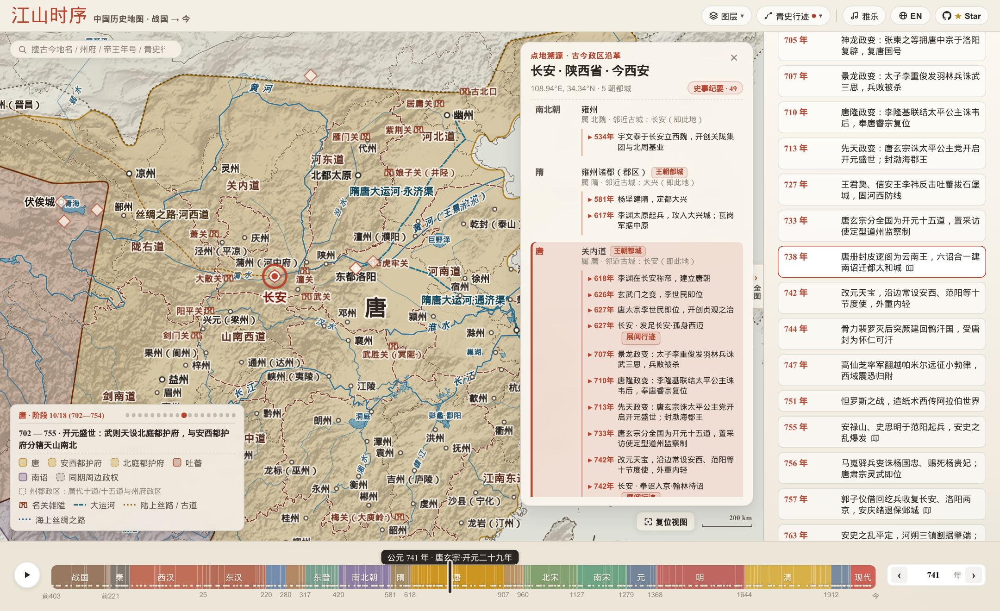
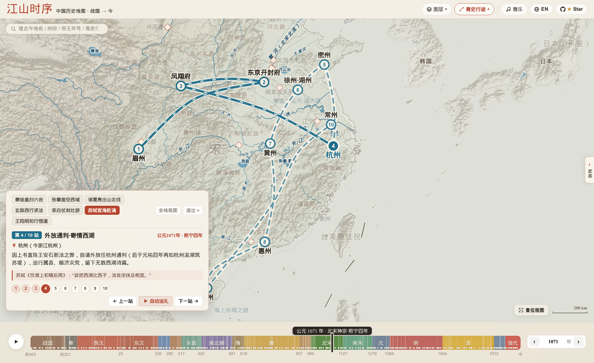
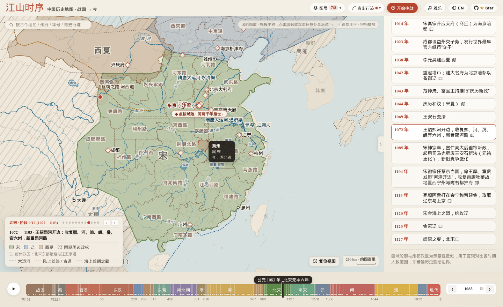
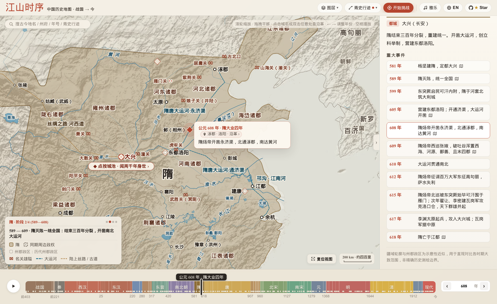
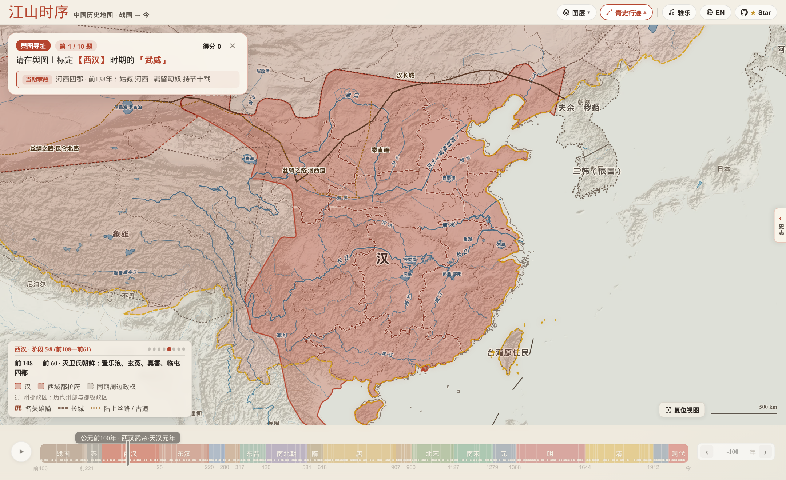

# 江山时序 · Chronicles of the Realm

**一幅可以拖动时间、点城读史、追随古人足迹的中国历史交互舆图（公元前 403 年三家分晋 — 今）**  
**An Interactive Historical Atlas of China from the Warring States (403 BCE) to the Present**

[**立即在线把玩 / Play Live Demo → https://deanchensj.github.io/jiangshan-map/**](https://deanchensj.github.io/jiangshan-map/)

---

## 这幅地图好玩在哪里？ / Why It's Fun to Explore

读史书、背古诗词时，你是否也常有这样的困惑：
- *「六朝古都建康、苏东坡被贬的黄州、岳飞北伐的朱仙镇，放在今天的地图上到底在哪儿？」*
- *「长安在两千年里换过多少个名字？这片土地上先后发生过多少场改写国运的大事？」*
- *「《资治通鉴》开篇的三家分晋与战国七雄、秦王嬴政十年扫六合、汉武帝打通河西走廊、唐朝极盛期的安西都护府、宋辽夏三足鼎立，版图是怎么一步步演变的？」*

**「江山时序」** 把从公元前 403 年（《资治通鉴》开篇 · 三家分晋）至今两千四百余年的王朝疆域、州郡变迁、历史风云与人物行迹装进了一张宣纸设色古舆图里。你不需要翻检厚重的历史地图册，只需拖动滑块、点点城池，就能在时空之间自由穿梭。

---

### 玩法一：点开任意一座城，读它两千四百年的身世与风云

在地图上**直接点击任意古城**（或者双击地图任意位置），就会展开一张 **「点地溯源」** 卡片：
- **看古今政区怎么变**：从战国七雄与秦朝的郡、汉朝的刺史部、唐朝的道、宋朝的路，一路看到明清的府省，哪几个朝代曾在此建都（`王朝都城` 徽章）一目了然。
- **看这里发生过什么大事**：每个朝代行下方直接内嵌当年发生在此地的历史大事（如咸阳的「商鞅变法」「秦王扫六合」、长安的「玄武门之变」「开元盛世」）。点一下右上角的 **「史事纪要」** 胶囊，还能一键筛出有大事发生的朝代；点击任意一条事件，时间轴和地图版图立即穿越回那一年！

> [点击直达：盛唐开元二十九年（741 年）· 点开长安看 33 桩千年风云 →](https://deanchensj.github.io/jiangshan-map/?year=741&trace=108.94,34.26)



---

### 玩法二：跟着秦始皇、张骞、诸葛亮、玄奘、李白、苏东坡、王阳明走一趟万里青史路

打开顶部工具栏的 **「青史行迹 ▾」**，右侧编年栏会自动收起腾出全幅山河视野，你可以化身历史同路人，沿着七条跨越万里与千载的经典路线逐站巡礼：
- **秦始皇一统六国行迹（前 238 — 前 221 年）**：从咸阳亲政平乱、王翦攻赵邺城拉开序幕，到内史腾灭韩、王翦克邯郸灭赵、易水破燕拔蓟城、王贲水灌大梁灭魏、王翦六十万大军破楚、远征辽东灭燕平代，直至南下临淄齐王建出降、六国一统——每点下一站，地图上的韩、赵、魏、楚、燕、齐便随之一步步并入大秦版图！
- **张骞凿空西域行迹（前 138 — 前 126 年）**：从长安出发，被匈奴羁留十余载不改其志，持汉节一路走到大宛、康居、大月氏。
- **诸葛亮出山北伐行迹（207 — 234 年）**：从襄阳隆中三顾茅庐、柴桑联吴破曹、溯江入蜀、白帝托孤、五月渡泸南征，到进驻汉中上《出师表》、祁山北伐与五丈原秋风星落。
- **玄奘西行求法行迹（627 — 645 年）**：孤身出玉门关，涉莫贺延碛、越凌山雪隘、渡印度河，抵那烂陀寺求法归唐。
- **李白仗剑壮游行迹（701 — 762 年）**：自安西碎叶入蜀居青莲，二十四岁仗剑出三峡、漫游扬州散金三十万、酒隐安陆、仰天大笑入长安供奉翰林、洛阳逢杜甫、白帝城遇赦放舟，终老当涂青山。
- **苏轼宦海贬谪行迹（1056 — 1101 年）**：从出川赴京、密州超然台赏月，到乌台诗案后贬谪黄州写下《赤壁赋》，再到惠州、跨海远谪海南儋州。
- **王阳明心学立功行迹（1472 — 1529 年）**：从余姚瑞云楼降生、京师抗疏下诏狱，到贬谪贵州修文「龙场悟道」始倡知行合一、庐陵讲学、巡抚南赣破山贼、三十五日生擒宁王朱宸濠、绍兴天泉证道揭出「致良知」，直至总督两广归途舟次南安留下「此心光明，亦复何言」。

每点「下一站」（或按空格键开启自动巡礼），**底下的历史年份、帝王年号、王朝版图都会跟着古人的脚步同步流转**，卡片里还会浮现他们当年在此地留下的《史记》《出师表》《传习录》或唐宋千古名篇。

> [点击直达：跟着苏东坡去密州与黄州（1075 — 1082 年）→](https://deanchensj.github.io/jiangshan-map/?journey=sushi&stop=6)



---

### 玩法三：拉动时间轴看天下分合，悬停州府查古今对号

- **同屏看多政权对峙**：从战国七雄（秦、楚、齐、燕、赵、魏、韩）与周、越、巴蜀、中山并立，到匈奴、突厥、吐蕃、回鹘，再到宋、辽、西夏、大理、金、蒙古，都以各自鲜明的设色同屏呈现。鼠标移到左下角图例的政权名字上，对应政权立刻高亮；点一下直接聚焦过去。
- **疆域盈亏「虚线残影」**：同一个朝代内部也有多次疆域伸缩（比如战国 9 个阶段、北宋 11 个阶段、唐朝 12 个阶段）。点左下角图例的阶段小圆点或时间轴右侧的 `‹ / ›` 步进按钮，图面会浮现上一阶段的朱砂虚线残影，哪块地是新开辟的、哪块地丢了，一眼看穿。
- **300+ 历史州府悬停即查**：放大地图，鼠标指到任意州郡（如北宋的「黄州」、三国的「荆州」），自动高亮州界，并告诉你它属于哪个政权、对应今天的哪个省。

> [点击直达：北宋元丰六年（1083 年）· 宋辽夏三足鼎立与「黄州」州境探查 →](https://deanchensj.github.io/jiangshan-map/?year=1083&zoom=1.85&center=113.5,31.2&hover=%E9%BB%84%E5%B7%9E)



---

### 玩法四：看千年工程动脉、量古代华里、听古琴雅乐

- **长城、运河与丝路随年代生长**：切到战国秦汉明看北长城与万里长城演进，切到隋大业四年（608 年）看隋炀帝开凿的永济渠、通济渠、邗沟、江南河如何把涿郡（今北京）、洛阳、江都（今扬州）与余杭（今杭州）连成一体，切到永乐年间看郑和船队下西洋。
- **读史专用的「公里 / 华里」双标比例尺**：右下角比例尺会随着缩放自动换算公里与传统华里（如 `200 km · 约四百里`），读史书看到「孤军深入三百里」时，直接在图上就能比划出有多远。
- **古琴「雅乐」伴读**：点一下顶部工具栏的 **「雅乐」**，伴着《流水》《平沙落雁》《阳关三叠》《醉渔唱晚》《酒狂》的古琴声慢慢看图，历史氛围直接拉满。

> [点击直达：隋大业四年（608 年）· 隋唐大运河贯通南北 →](https://deanchensj.github.io/jiangshan-map/?year=608)



---

### 玩法五：舆图寻址挑战 —— 测测你在古代能当几品官？

觉得自己历史地理很熟？点右上角的 **「开始挑战」** 试试身手：
- **当朝掌故线索 + 舆图盲猜扎针**：地图隐去所有城池标注，题目给出「南宋时期的泉州」「六朝古都建康」或「元代的奉元路」，并附上**当朝掌故与史事线索**（不剧透现代城市名），凭你的山河水系直觉在舆图上扎针（手机端支持「先落针微调、再确认作答」防误触），系统按你的落点与真实古城的球面距离打分！
- 十道题答完，系统会根据总分授予你 **「太史令 · 舆图大家」「职方郎中」「州郡从事」** 等传统官阶封号。

> [点击直达：开启「舆图寻址」挑战模式 →](https://deanchensj.github.io/jiangshan-map/?year=741&quiz=locate)



---

## 实用快捷键与任意门（Deep Links）

### 快捷键一览

| 操作 / 按键 | 作用 |
| :--- | :--- |
| **`/`** 或 **`Cmd/Ctrl + K`** | 唤醒左上角**万能搜索框**：搜古今地名（`咸阳`/`长安`）、州府（`黄州`）、年号（`贞观`/`元丰六年`）、年份（`-260`/`1083`）、事件（`长平之战`/`淝水之战`）或人物行迹（`秦始皇`/`诸葛亮`/`李白`/`苏轼`/`王阳明`） |
| **`←` / `→`** 或底部 **`‹ / ›`** | 键盘左右键向前 / 向后走 `10` 年（按住 `Shift` 走 `50` 年）；点击底部 **`‹ / ›`** 按钮直接跳往上 / 下一关键历史节点或行迹站点 |
| **`Space`（空格键）** | 自动播放 / 暂停历史演进（行迹模式下自动巡礼） |
| **`单击古城` / `双击地图`** | 打开该地从战国到近现代的 18 时期「点地溯源 + 史事纪要」卡片 |
| **`悬停 / 点击图例色块`** | 悬停单独高亮该政权疆域；点击自动缩放聚焦至该政权 |

### 一键直达链接（适合分享给朋友）

你可以直接在网址后面加上参数，把某个特定的历史瞬间分享给朋友：
- **看某一年**：[`?year=-403`](https://deanchensj.github.io/jiangshan-map/?year=-403)（《资治通鉴》开篇 · 三家分晋） / [`?year=-260`](https://deanchensj.github.io/jiangshan-map/?year=-260)（战国长平之战） / [`?year=741`](https://deanchensj.github.io/jiangshan-map/?year=741)（盛唐开元二十九年）
- **看某场大战**：[`?year=-260&event=-260`](https://deanchensj.github.io/jiangshan-map/?year=-260&event=-260)（长平之战） / [`?year=383&event=383`](https://deanchensj.github.io/jiangshan-map/?year=383&event=383)（东晋前秦 · 淝水之战）
- **查某座古城的千年故事**：[`?year=741&trace=108.94,34.26`](https://deanchensj.github.io/jiangshan-map/?year=741&trace=108.94,34.26)（长安/西安） / [`?year=1083&trace=114.35,34.79`](https://deanchensj.github.io/jiangshan-map/?year=1083&trace=114.35,34.79)（大梁/东京汴梁/开封）
- **走一段人物行迹**：[`?journey=qinshihuang`](https://deanchensj.github.io/jiangshan-map/?journey=qinshihuang)（秦始皇一统六国） / [`?journey=zhangqian`](https://deanchensj.github.io/jiangshan-map/?journey=zhangqian)（张骞凿空西域） / [`?journey=zhugeliang`](https://deanchensj.github.io/jiangshan-map/?journey=zhugeliang)（诸葛亮出山北伐） / [`?journey=xuanzang`](https://deanchensj.github.io/jiangshan-map/?journey=xuanzang)（玄奘西行求法） / [`?journey=libai`](https://deanchensj.github.io/jiangshan-map/?journey=libai)（李白仗剑壮游） / [`?journey=sushi`](https://deanchensj.github.io/jiangshan-map/?journey=sushi)（苏轼宦海贬谪） / [`?journey=wangyangming`](https://deanchensj.github.io/jiangshan-map/?journey=wangyangming)（王阳明心学立功）
- **直接开一局挑战**：[`?quiz=locate`](https://deanchensj.github.io/jiangshan-map/?quiz=locate)（舆图寻址挑战）
- **切换英文版**：[`?lang=en`](https://deanchensj.github.io/jiangshan-map/?lang=en)

---

## English Overview

**Chronicles of the Realm (`jiangshan-map`)** is an interactive historical atlas of China from the opening year of Sima Guang's *Zizhi Tongjian*—the Partition of Jin and the Warring States (403 BCE)—to the present day, crafted in the aesthetic of traditional Chinese parchment cartography.

### What You Can Do

1. **Click Any Ancient City to Uncover 2,400 Years of Stories (`Trace Place`)**: Click any city (or double-click anywhere on the map) to see how its name and administrative jurisdiction evolved across 18 historical eras, which kingdoms and empires crowned it as their capital, and every major historical event that unfolded there—click any event to time-travel straight to that year.
2. **Walk in the Footsteps of Historical Figures (`Historical Journeys`)**: Follow **Qin Shi Huang's Unification Campaigns** (238–221 BCE, watching Han, Zhao, Wei, Chu, Yan, and Qi merge into Qin step by step), **Zhang Qian's** mission to the Western Regions (138–126 BCE), **Zhuge Liang's** emergence from Longzhong and Northern Expeditions (207–234 CE), **Xuanzang's** pilgrimage to India (627–645 CE), **Li Bai's** grand travels across Tang China (701–762 CE), **Su Shi's** literary exile across Song China (1056–1101 CE), or **Wang Yangming's** Philosophy of Mind and campaigns (1472–1529 CE).
3. **Scrub Through 2,400+ Years & Inspect 300+ Ancient Prefectures**: Watch kingdoms and empires rise, split, and reunify across 124 territorial stages (134 snapshots) with dashed **Ghost Boundary Diffs** showing exact frontier shifts. Zoom in and hover over 300+ historical prefectures (*Zhou / Fu / Jun*) to see their modern provincial counterparts.
4. **Explore Historical Megaprojects & Listen to Classical Guqin (`雅乐`)**: Trace the Warring States, Qin, Han, and Ming Great Walls, the Grand Canal, the Silk Road, and Zheng He's maritime voyages; measure distances with a live **km / traditional Chinese *li*** dual scale bar; and toggle full-data English (`EN`) or classical Guqin music in one click.
5. **Play the Map Pinpoint Challenge**: Test your historical intuition by pinpointing unlabeled ancient cities on the map using dynastic historical clues across 10 rounds to earn traditional imperial court titles.

---

## 本地运行 / Run Locally

项目为纯静态网页，无需安装任何依赖或构建工具，克隆后用任意静态服务器打开即可：  
No dependencies or build steps required. Clone and serve with any static HTTP server:

```bash
git clone https://github.com/DeanChensj/jiangshan-map.git
cd jiangshan-map
python3 -m http.server 8000
```

随后在浏览器打开 `http://localhost:8000`。

---

## 致谢与开源协议 / Credits & License

- **历史疆域与政区参考 / Historical GIS References**: Tan Qixiang's *The Historical Atlas of China* (谭其骧主编《中国历史地图集》), **CHGIS** (Harvard Yenching Institute & Fudan University), **Robert M. Hartwell** historical GIS datasets, and [aourednik/historical-basemaps](https://github.com/aourednik/historical-basemaps) (GPL-3.0).
- **现代省界参考 / Modern Provincial Reference**: DataV GeoAtlas open boundary data.
- **古琴雅乐录音 / Classical Guqin Audio**: Wikimedia Commons public-domain recordings (*Liu Shui*, *Pingsha Luoyan*, *Yangguan Sandie*, *Zuiyu Changwan*, *Jiu Kuang*).
- **说明 / Note**: 地图中的历史疆域轮廓与州郡政区边界为示意性近似，旨在直观呈现各时期大致统治与管辖范围，非精确现代测绘边界。
- **开源协议 / License**: **GPL-3.0**.
