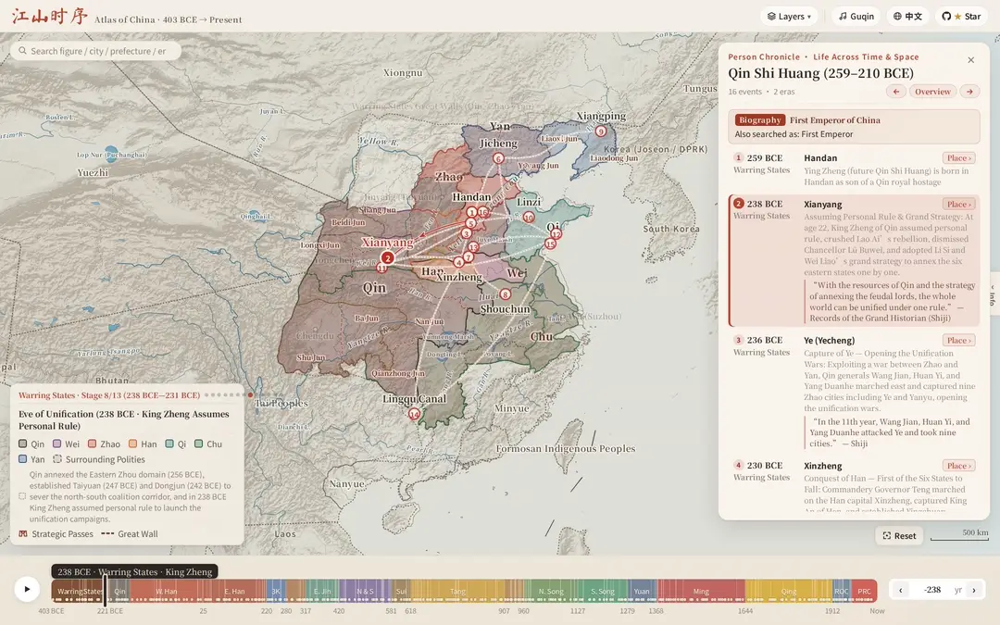
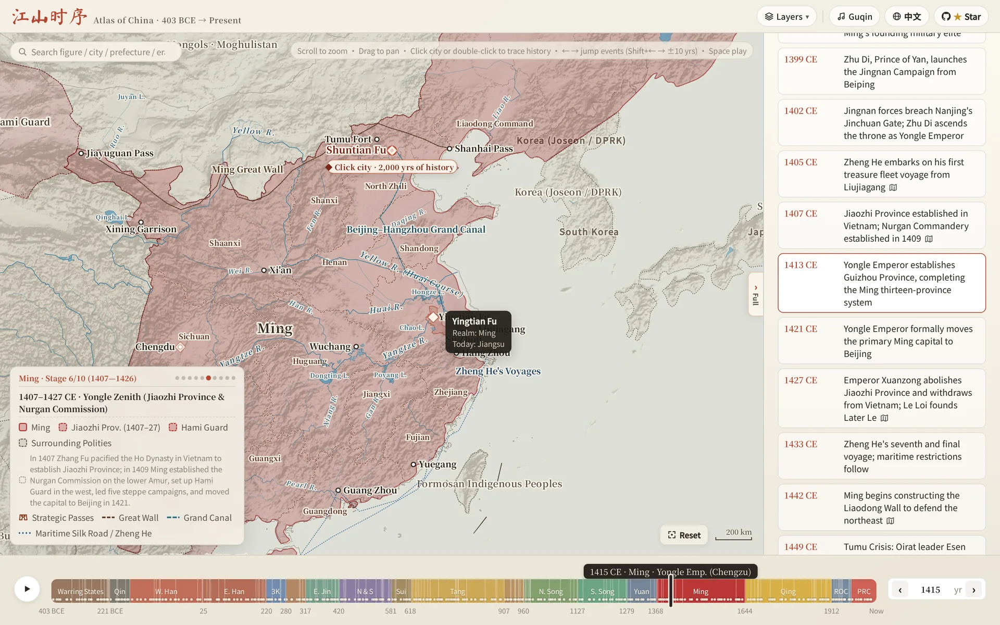
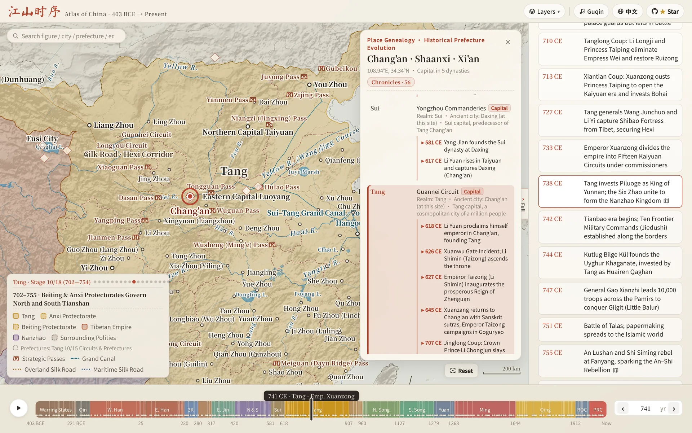
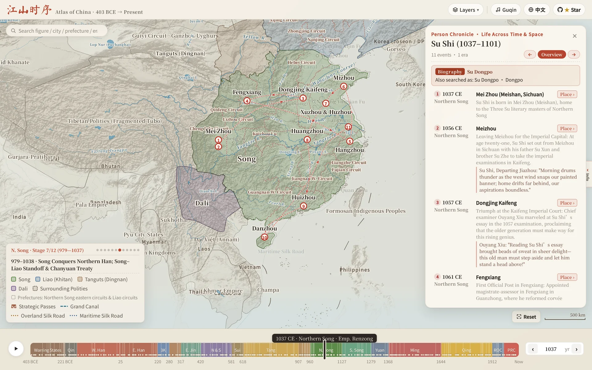
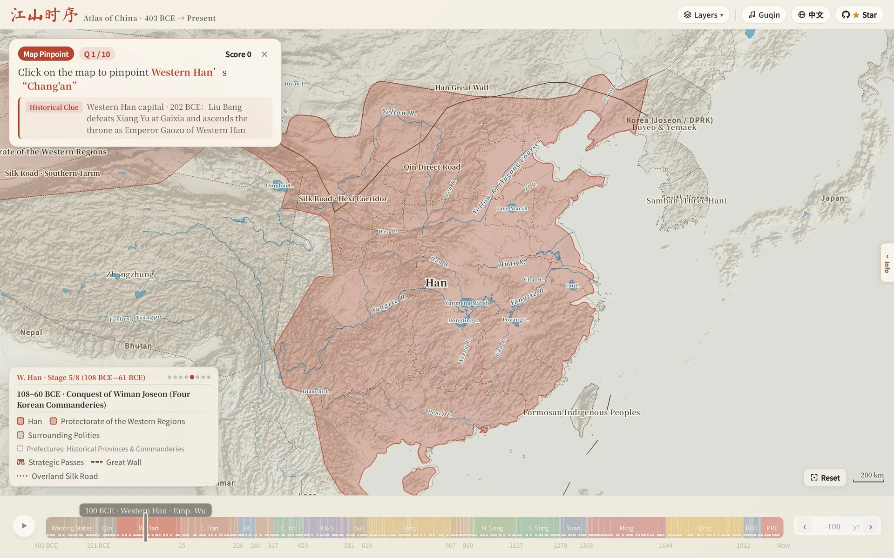

# Chronicles of the Realm · 江山时序

<p align="left">
  <strong>English</strong> · <a href="README_ZH.md">简体中文 (Chinese)</a>
</p>

**An Interactive Historical Atlas of China from the Warring States (403 BCE) to the Present — Scrub Through Time, Trace Ancient Cities, and Walk in the Footsteps of History**

[**Play Live Demo (English UI) → https://deanchen.me/jiangshan-map/?lang=en**](https://deanchen.me/jiangshan-map/?lang=en)

*The story behind it (in Chinese): [From textbook maps to 1k GitHub stars](https://deanchen.me/history/atlas/2026/10/25/jiangshan-map-story.html)*

<p align="center">
  <a href="https://deanchen.me/jiangshan-map/?lang=en">
    
  </a>
</p>

---

## Why It's Fun to Explore

Have you ever wondered while reading Chinese history or classical poetry:
- *"Where exactly on today's map are Jiankang (the Six Dynasties capital), Huangzhou (where Su Dongpo composed the Red Cliffs Rhapsody in exile), Languan Pass in the Qinling Mountains (where Han Yu halted his horse in the snow), or Zhuxianzhen (Yue Fei's northern campaign frontier)?"*
- *"How many names did Chang'an hold across two millennia, and what pivotal events unfolded on that soil?"*
- *"How did the realm evolve step by step—from the Partition of Jin and the Seven Warring States at the opening of Sima Guang's Zizhi Tongjian (403 BCE), Qin's unification campaigns, Emperor Wu of Han opening the Hexi Corridor, High Tang's Four Garrisons of Anxi, and Yuan's Xuanzhengyuan jurisdiction over Tibet, to Zeng Jize's recovery of Ili (1881 CE) and the 20th-century shift from the 'Begonia Leaf' (秋海棠) map to the 'Rooster' (雄鸡) map?"*

**Chronicles of the Realm (`jiangshan-map`)** brings together **2,400+ years** of Chinese history across **18 historical periods** into a single interactive parchment atlas—featuring **multi-stage territorial and prefecture snapshots**, **ancient cities**, **strategic mountain passes**, **poetic and battlefield landmarks**, **chronological milestones**, and **reigning monarchs & imperial eras**. No heavy print atlases required—just drag the timeline and click any city to travel through space and time.

---

### Feature 1: Scrub the Timeline to Watch Realms Rise & Fall, Track Monarchs, and Compare Ancient & Modern Borders

- **Multi-Polity Confrontations on a Single Canvas**: From the Seven Warring States (Qin, Chu, Qi, Yan, Zhao, Wei, Han) alongside Zhou, Yue, Ba-Shu, Zhongshan, and Yiqu, to the Three Kingdoms warlords (Yuan Shao, Cao Cao, Liu Bei, Sun Quan, Gongsun's Liaodong), Northern & Southern Dynasties, Five Dynasties & Ten Kingdoms, and Song, Liao, Western Xia, Dali, Jin, and the Mongols—all rendered side-by-side in high-contrast traditional parchment hues. Hover over any polity in the bottom-left legend to highlight its territory, or click to zoom straight to it.
- **Multi-Stage Territorial Evolution & Dashed "Ghost Boundary Diffs"**: At every major territorial milestone—such as Qin's conquest of Ba-Shu (316 BCE), Yan General Qin Kai's expansion into Liaodong (300 BCE), Ma Yuan's bronze pillars in Jiaozhi (43 CE), Sima Yi's campaign in Liaodong (238 CE), Li Jing's conquest of Tuyuhun (635 CE), the Four Garrisons of Anxi & Wang Xuance's campaign in Central India (648 CE), Yuan's Xuanzhengyuan rule over Tibet (1288 CE), Ming's Hami & Seven Guards West of Jiayuguan (1404 CE), the 1881 Treaty of Saint Petersburg recovering Ili, the 1898 foreign leased territories, the 1945 retrocession of Taiwan, and the 1946 transition from the **"Begonia Leaf" (秋海棠)** map to the **"Rooster" (雄鸡)** map—click any milestone or phase dot to switch maps and reveal the previous phase's dashed vermilion **Ghost Boundary Diff** so territorial gains and losses are immediately visible.
- **Inline Reigning Monarch & Imperial Era Display**: The timeline dynamically displays the reigning monarch (temple/posthumous title + personal name + reign span, e.g., `Emperor Wu of Han · Liu Che`, `Emperor Taizong of Tang · Li Shimin`, `Emperor Shengzu of Qing · Xuanye`) alongside the exact imperial era year.
- **Ancient Prefecture Hover Inspection & Modern X-Ray Lens**: First-level administrative divisions (Commanderies, Circuits, Routes, and Provinces) are rendered with deduplicated **Parchment Casing** borders. Zoom in and hover over any prefecture (e.g., Ming `Yingtian Prefecture` or Three Kingdoms `Jingzhou`) to inspect its jurisdiction and modern provincial equivalents, or toggle the **X-Ray Lens** to project modern provincial boundaries directly over the historical map.
- **Dynamic River Courses, Ancient Lakes & Grand Engineering Works**: As you scrub through time, historical shifts of the Yellow River, expanding and shrinking ancient lakes (*Yunmeng Marsh*, *Lop Nur / Puchanghai*), Warring States/Qin/Han/Ming Great Walls, Sui-Tang & Grand Canals, the Silk Road, and Zheng He's maritime routes evolve in lockstep with each era.

> [Try It Live: Ming Dynasty Yongle 13 (1415 CE) · Two Capitals, Thirteen Provinces & "Yingtian Prefecture" Inspection →](https://deanchen.me/jiangshan-map/?year=1415&zoom=1.75&center=115.8,33.2&hover=Yingtian%20Prefecture&lang=en)



---

### Feature 2: Click Any Ancient City or Strategic Pass to Uncover 2,400 Years of History (`Trace Place`)

**Click any ancient city or mountain pass** on the map (or double-click anywhere on the canvas) to open its **Trace Place** genealogy card:
- **Bilingual City Lore Banner & 2,400-Year Administrative Genealogy**: At the top of the card, read a curated **poetic epigraph and historical biography** for the city; below, trace how its name and administrative jurisdiction evolved across all 18 historical eras—from Warring States and Qin commanderies, Han regional inspectorates, Tang circuits, and Song routes to Yuan/Ming/Qing provinces and modern municipalities—complete with `Imperial Capital` badges and dynastic seat remarks.
- **Site-Specific Landmark Events**: Beneath each dynasty row, inspect major historical events that took place right on that spot (e.g., *Shang Yang's Reforms* and *Qin's Unification* at Xianyang, *Guan Yu Flooding the Seven Armies* at Fancheng, the *Xuanwu Gate Incident* at Chang'an, or *Yue Fei's Martyrdom* at Lin'an). Click the **`Key Events`** pill in the top-right of the card to filter for dynasties with major events, and click any event to time-travel straight to that year!
- **Strategic Mountain Passes & Poetic / Battlefield Landmarks**: Explore famous mountain passes—including *Hangu Pass*, *Tongguan*, *Jianmen Pass*, *Yanmen Pass*, *Yumen Pass*, *Yangguan*, and *Shanhai Pass*—rendered with traditional *Hanque* gatehouse icons and strategic terrain notes, alongside famous battlefields and literary landmarks such as *Red Cliffs (Chibi)*, *Gaixia*, *Wuzhang Plains*, *Orchid Pavilion (Lanting)*, *Yueyang Tower*, *Pavilion of Prince Teng*, *Languan Pass*, *Loulan*, *Lop Nur*, and *Issyk-Kul*.

> [Try It Live: High Tang Kaiyuan 29 (741 CE) · Open Chang'an's 2,400-Year Genealogy Card →](https://deanchen.me/jiangshan-map/?year=741&place=Chang'an&lang=en)



---

### Feature 3: Person Chronicles — Trace Any Historical Figure Across Time & Space

Click the top-left **Universal Search Box** (with a rotatable `e.g.` figure preview and quick-search chips, or type any monarch, general, statesman, monk, or poet such as `Cao Cao`, `Huo Qubing`, `Sima Qian`, `Yue Fei`, or `Zheng He`) to open **Person Chronicle (`点人溯事`)**, plotting every milestone of their life with delicate cartographic hairline arcs and directional ticks across changing dynastic borders:
- **Qin Shi Huang's Unification Campaigns (238–221 BCE)**: From suppressing the rebellion at Xianyang and Wang Jian's attack on Ye, to the fall of Han, Zhao, Yan, Wei, Chu, and Dai, culminating in the surrender of Qi at Linzi—as you advance stop by stop, watch the six rival kingdoms merge into the Qin Empire right on the map!
- **Zhang Qian's Mission to the Western Regions (138–126 BCE)**: Depart Chang'an, endure over a decade of Xiongnu captivity without surrendering the Han imperial staff, and blaze the trail to Dayuan (Fergana), Kangju, and the Greater Yuezhi.
- **Zhuge Liang's Emergence & Northern Expeditions (207–234 CE)**: From the Three Visits at Longzhong and the alliance at Chaisang before Red Cliffs, to entering Shu, the White Emperor City entrustment, the Southern Campaign across the Lu River, Hanzhong's *Memorial on Deploying the Troops*, Mount Qi, and the autumn winds of Wuzhang Plains.
- **Xuanzang's Pilgrimage to India (627–645 CE)**: Slip past Yumen Pass alone across the Moheyan Desert, scale the icy Bedel Pass, cross the Indus, study at Nalanda Monastery, and debate at Kanyakubja (Kanauj) before returning to Chang'an.
- **Li Bai's Grand Travels Across Tang China (701–762 CE)**: From Suyab and boyhood in Shu, sailing out through the Three Gorges at twenty-four, scattering gold in Yangzhou, serving in the Hanlin Academy at Chang'an, meeting Du Fu in Luoyang, receiving amnesty at White Emperor City, to his final years at Dangtu.
- **Su Shi's Literary Exile Across Song China (1056–1101 CE)**: From leaving Meishan for the capital Kaifeng and gazing at the moon in Mizhou, to composing the *Red Cliffs Rhapsody* in Huangzhou exile, Huizhou, and crossing the sea to Danzhou on Hainan Island.
- **Wang Yangming's Unity of Knowledge & Action (1472–1529 CE)**: From birth in Yuyao and imprisonment in Beijing, to his enlightenment at Longchang in Guizhou, pacifying bandits in Southern Ganzhou, capturing the rebel Prince of Ning in 35 days, teaching at the Tianquan Bridge in Shaoxing, and his final words *"This mind is bright and clear; what more is there to say?"* at Nan'an.

Each time you step to the next event (`‹ / ›`, `← / →`, or `Space` to auto-play), **the timeline year, reigning monarch, imperial era, and dynastic territories evolve in sync with their footsteps**, highlighting the active transition arc alongside bilingual primary-source excerpts and poems written at that exact site.

> [Try It Live: Follow Su Dongpo's Exile to Mizhou & Huangzhou (1075–1082 CE) →](https://deanchen.me/jiangshan-map/?person=sushi&lang=en)



---

### Feature 4: Easter Egg · Map Pinpoint Challenge — What Imperial Court Rank Would You Earn?

Think you know Chinese historical geography? Click **`Quiz ›`** in the corner of the **Universal Search Box** guide bar (or type `quiz` for **`Map Pinpoint · Ancient Place Quiz`**):
- **Dynastic Historical Clues + Blind Map Pinpointing**: City labels are hidden while the prompt asks you to locate an ancient city across a 10-round progressive difficulty deck—accompanied by **dynastic historical clues** (without spoiling the modern city name). Drop your pin to preview and adjust, click the on-pin **`✓ Confirm`** button to lock in your answer with concentric distance score rings, and earn points based on great-circle distance to the true coordinates!
- Complete 10 rounds to receive a traditional imperial cartographic title such as **Grand Historian & Master Cartographer (太史令 · 舆图大家)**, **Director of the Bureau of Operations (职方郎中)**, or **Prefectural Retainer (州郡从事)**.

> [Try It Live: Western Han Emperor Wu, Yuanshou 2 (121 BCE) · Start the Map Pinpoint Challenge →](https://deanchen.me/jiangshan-map/?year=-121&quiz=locate&lang=en)



---

## Keyboard Shortcuts & Shareable Deep Links

### Keyboard Shortcuts

| Key / Action | Effect |
| :--- | :--- |
| **`/`** or **`Cmd/Ctrl + K`** | Focus the **Universal Search Box**: search **historical figures** (`Qin Shi Huang`/`Zhang Qian`/`Su Shi`), **ancient & modern cities** (`Xianyang`/`Chang'an`/`Luoyang`/`Kaifeng`), **reigning monarchs** (`Emperor Wu of Han`/`Taizong of Tang`/`Liu Che`/`Li Shimin`), **imperial eras** (`Zhenguan`/`Yongle`/`Kangxi`), **poetic & battlefield landmarks** (`Red Cliffs`/`Wuzhang Plains`/`Languan`/`Lanting`), **mountain passes** (`Hangu Pass`/`Jianmen Pass`/`Yumen Pass`), **historical events**, or the **Ancient Place Quiz** |
| **`←` / `→`** or bottom **`‹ / ›`** | Jump to the previous / next historical phase, milestone event, or person event stop (hold `Shift + ← / →` to step by `10` years) |
| **`Space`** | Auto-play / pause timeline evolution (or auto-advance stops in Person Chronicle mode) |
| **`Esc`** | Close active popups/cards, clear search highlights, or exit custom multi-stop routes |
| **`Single-click city` / `Double-click map`** | Open the 18-era **Trace Place & Key Events** genealogy card for that location |
| **`Hover / Click legend swatch`** | Hover to isolate & highlight that polity's territory; click to auto-zoom to its bounding box |

### Shareable Deep Links

Append query parameters to share any historical moment, battle, city genealogy, or multi-stop route:
- **Jump to a specific year or territorial shift**: [`?year=-403&lang=en`](https://deanchen.me/jiangshan-map/?year=-403&lang=en) (403 BCE · Partition of Jin) / [`?year=-121&lang=en`](https://deanchen.me/jiangshan-map/?year=-121&lang=en) (121 BCE · Huo Qubing opens the Hexi Corridor) / [`?year=648&lang=en`](https://deanchen.me/jiangshan-map/?year=648&lang=en) (648 CE · Four Garrisons of Anxi & Wang Xuance in India) / [`?year=1288&lang=en`](https://deanchen.me/jiangshan-map/?year=1288&lang=en) (1288 CE · Yuan Xuanzhengyuan over Tibet) / [`?year=1881&lang=en`](https://deanchen.me/jiangshan-map/?year=1881&lang=en) (1881 CE · Zeng Jize recovers Ili) / [`?year=1945&lang=en`](https://deanchen.me/jiangshan-map/?year=1945&lang=en) (1945 CE · Retrocession of Taiwan)
- **Pinpoint a famous battle**: [`?year=-260&place=长平&lang=en`](https://deanchen.me/jiangshan-map/?year=-260&place=长平&lang=en) (Battle of Changping) / [`?year=208&place=赤壁&lang=en`](https://deanchen.me/jiangshan-map/?year=208&place=赤壁&lang=en) (Battle of Red Cliffs) / [`?year=383&place=淝水&lang=en`](https://deanchen.me/jiangshan-map/?year=383&place=淝水&lang=en) (Battle of Fei River)
- **Inspect a city's 2,400-year genealogy**: [`?year=741&place=长安&lang=en`](https://deanchen.me/jiangshan-map/?year=741&place=长安&lang=en) (Chang'an / Xi'an) / [`?year=1415&place=应天府&lang=en`](https://deanchen.me/jiangshan-map/?year=1415&place=应天府&lang=en) (Jiankang / Yingtian / Nanjing) / [`?year=819&place=蓝关&lang=en`](https://deanchen.me/jiangshan-map/?year=819&place=蓝关&lang=en) (Han Yu at Languan Pass)
- **Plot a custom poetic or campaign route**: [`?year=763&place=剑外,巴峡,巫峡,襄阳,洛阳&lang=en`](https://deanchen.me/jiangshan-map/?year=763&place=剑外,巴峡,巫峡,襄阳,洛阳&lang=en) (Du Fu's 763 CE homeward route) / [`?year=1079,1080,1094,1097&place=湖州,黄州,惠州,儋州&lang=en`](https://deanchen.me/jiangshan-map/?year=1079,1080,1094,1097&place=湖州,黄州,惠州,儋州&lang=en) (Su Shi's multi-year exile route across Huzhou, Huangzhou, Huizhou, and Danzhou)
- **Open a person's spatio-temporal chronicle**: [`?person=qinshihuang&lang=en`](https://deanchen.me/jiangshan-map/?person=qinshihuang&lang=en) (Qin Shi Huang) / [`?person=zhangqian&lang=en`](https://deanchen.me/jiangshan-map/?person=zhangqian&lang=en) (Zhang Qian) / [`?person=zhugeliang&lang=en`](https://deanchen.me/jiangshan-map/?person=zhugeliang&lang=en) (Zhuge Liang) / [`?person=xuanzang&lang=en`](https://deanchen.me/jiangshan-map/?person=xuanzang&lang=en) (Xuanzang) / [`?person=libai&lang=en`](https://deanchen.me/jiangshan-map/?person=libai&lang=en) (Li Bai) / [`?person=sushi&lang=en`](https://deanchen.me/jiangshan-map/?person=sushi&lang=en) (Su Shi) / [`?person=wangyangming&lang=en`](https://deanchen.me/jiangshan-map/?person=wangyangming&lang=en) (Wang Yangming)
- **Start a quiz round**: [`?year=-121&quiz=locate&lang=en`](https://deanchen.me/jiangshan-map/?year=-121&quiz=locate&lang=en) (Map Pinpoint Challenge)
- **Switch UI language**: [`?lang=en`](https://deanchen.me/jiangshan-map/?lang=en) (English) / [`?lang=zh-tw`](https://deanchen.me/jiangshan-map/?lang=zh-tw) (Traditional Chinese) / [`/`](https://deanchen.me/jiangshan-map/) (Simplified Chinese)

---

## AI Agent, MCP & LLM Integration

**Chronicles of the Realm** works out of the box as a **historical-geography visualization engine for LLMs, MCP Clients, and AI Agents**. Models **never need to guess latitude/longitude coordinates**—simply extract two semantic parameters from a poem or historical text, **`year`** and **`place`**, and the atlas automatically resolves ancient/modern place names, centers the camera, renders dynastic borders and multi-stop trajectories, and opens the **Trace Place** genealogy card:

- **Machine-Readable Specification**: [`llms.txt`](llms.txt)
- **Zero-Dependency Local MCP Server (`stdio`)**: [`scripts/mcp_server.js`](scripts/mcp_server.js) — add to Claude Desktop, Cursor, Windsurf, or Gemini CLI `mcpServers`:
  ```json
  {
    "mcpServers": {
      "jiangshan-atlas": {
        "command": "node",
        "args": ["/absolute/path/to/jiangshan-map/scripts/mcp_server.js"]
      }
    }
  }
  ```
  Exposes 3 native MCP tools (`<5ms` offline response, zero npm dependencies):
  - `inspect_place({ year, place, lang? })`: Returns reigning monarch/era, controlling regime (`polity`), macro-region (`dao/lu/province`), prefecture (`jun/zhou/fu`), modern province/city, 2,400-year `lore`, and shareable deep-link URL.
  - `inspect_person({ person, stop?, lang? })`: Returns a historical figure or monarch's biography, chronological geocoded stops across dynasties, and shareable deep-link URL.
  - `search_atlas({ query, limit?, lang? })`: Searches across all ancient cities, poetic & battlefield landmarks, mountain passes, historical figures, imperial eras, and chronological milestones.
- **Ready-to-Use Agent Skill**: [`skills/jiangshan-atlas/SKILL.md`](skills/jiangshan-atlas/SKILL.md) (includes the zero-dependency CLI renderer [`skills/jiangshan-atlas/scripts/jiangshan.py`](skills/jiangshan-atlas/scripts/jiangshan.py))
  ```bash
  # Install into Claude Code / Gemini / Jetski global skills directory:
  mkdir -p ~/.claude/skills ~/.gemini/config/skills && cp -r skills/jiangshan-atlas ~/.claude/skills/ && cp -r skills/jiangshan-atlas ~/.gemini/config/skills/
  ```

### 1. Zero-Coordinate Dual-Parameter URL Protocol (0D Pinpoint / 1D Same-Year Route / 4D Multi-Year Route)

| Mode | Example URL | Automatic Rendering Behavior |
| :--- | :--- | :--- |
| **Single-Point Pinpoint (0D)** | [`?year=819&place=蓝关&lang=en`](https://deanchen.me/jiangshan-map/?year=819&place=蓝关&lang=en)<br>*(Han Yu's 819 CE exile poem at Languan Pass)* | Jumps to Tang Yuanhe 14 (819 CE), drops a pin on Languan Pass in the Qinling Mountains, and opens its 2,400-year administrative genealogy card |
| **Same-Year Multi-Stop Route (1D)** | [`?year=763&place=剑外,巴峡,巫峡,襄阳,洛阳&lang=en`](https://deanchen.me/jiangshan-map/?year=763&place=剑外,巴峡,巫峡,襄阳,洛阳&lang=en)<br>*(Du Fu's 763 CE poem on recapturing Henan & Hebei)* | Plots numbered vermilion arcs `1` → `5` across the 763 CE Tang map and auto-fits the viewport; click any stop to inspect its genealogy |
| **Multi-Year Space-Time Route (4D)** | [`?year=1079,1080,1094,1097&place=湖州,黄州,惠州,儋州&lang=en`](https://deanchen.me/jiangshan-map/?year=1079,1080,1094,1097&place=湖州,黄州,惠州,儋州&lang=en)<br>*(Su Shi's career across Huzhou, Huangzhou, Huizhou & Danzhou)* | Pairs `year[i]` with `place[i]`, labeling stops with their historical years and switching the underlying dynastic map whenever you click a stop |

### 2. CLI One-Command Screenshot & JSON Lookup (for Agent Tool Calls)

```bash
# Single-point poetic landmark screenshot
python3 skills/jiangshan-atlas/scripts/jiangshan.py --year 819 --place 蓝关 --out /tmp/languan_819.png

# Same-year multi-stop trajectory screenshot
python3 skills/jiangshan-atlas/scripts/jiangshan.py --year 763 --place 剑外,巴峡,巫峡,襄阳,洛阳 --out /tmp/dufu_763.png

# Multi-year space-time trajectory screenshot
python3 skills/jiangshan-atlas/scripts/jiangshan.py --year 1079,1080,1094,1097 --place 湖州,黄州,惠州,儋州 --out /tmp/sushi_exile.png
```

### 3. Browser JavaScript API (`window.atlasAPI`) & In-Browser WebMCP (`navigator.modelContext`)

In browser automation environments (Playwright) or WebMCP-enabled AI browsers (`navigator.modelContext`), the page automatically registers `jiangshan_locate`, `jiangshan_inspect`, and `jiangshan_open_person`, and exposes `window.atlasAPI`:
- `window.atlasAPI.locate({ year, place, zoom? })`: Drives the map to a single location or multi-stop trajectory and returns structured historical-geographic metadata.
- `window.atlasAPI.inspect({ year, place, person?, stop? })`: Read-only query returning the controlling polity, ancient prefecture, modern province/city, leg distances, person events, and canonical shareable URL.
- `window.atlasAPI.resolvePlace(place, year?)`: Resolves ancient and modern names for cities, strategic passes, poetic landmarks, and battlefields.
- `window.atlasAPI.openPerson(person, stop?)` & `window.atlasAPI.search(query)`: Opens a person chronicle on the map or searches across the entire atlas.

---

## Run Locally

No dependencies or build steps required. Clone and serve with any static HTTP server:

```bash
git clone https://github.com/DeanChensj/jiangshan-map.git
cd jiangshan-map
python3 -m http.server 8000
```

Then open `http://localhost:8000` in your browser.

---

## GeoJSON Export (for Leaflet / MapLibre / QGIS)

The app ships its geometry as compact topology-deduplicated VLQ bundles. To use the vector layers in other projects, generate standard RFC 7946 GeoJSON (EPSG:4326, lon/lat) locally; the output goes to `geojson/` and is not committed. The export covers 403 BCE to 1948; later years and the modern province layer are not included.

```bash
node scripts/export_geojson.js            # or: node scripts/export_geojson.js <outDir>
```

- `snapshots/<id>.geojson` — one file per territorial phase; each feature has a `bbox` and `layer` (`polity` / `region` / `prefecture`), `title`, `title_en`, `category`, `tint`, `anchor`.
- `index.json` — every dynasty's phases with `from` / `to` years (negative = BCE, no year 0) and the matching snapshot file.
- `corridors.geojson` (walls, canals, roads, sea routes), `settlements.geojson`, `milestones.geojson`, `neighbors.geojson`, and `modern/` (rivers, lakes, hydro labels; `appear` / `vanish` give the years historical river courses and lakes are shown).

To look up a point without loading every phase, use [`geojson/jiangshan-locate.js`](geojson/jiangshan-locate.js): it loads `index.json` plus only the snapshot covering the year, then runs a bbox-filtered point-in-polygon test.

```js
const atlas = JiangshanLocate.create(); // or create({ base: '<url of geojson/>' })
const hit = await atlas.locate(118.78, 32.06, 1415); // lon, lat, year
hit.polity.properties.title;     // 明
hit.region.properties.title;     // 南直隶
hit.prefecture.properties.title; // 应天府 (a GeoJSON Feature: L.geoJSON(hit.prefecture))
```

After exporting, serve the repository (`python3 -m http.server 8000`) and open `http://localhost:8000/geojson/demo.html` for a Leaflet example: drag the year slider, click the map, or open `demo.html?year=1415&lon=118.78&lat=32.06` to load, highlight and zoom automatically. The data is GPL-3.0, and historical borders are schematic approximations.

---

## Credits & License

- **Historical GIS References**: Tan Qixiang's *The Historical Atlas of China* (谭其骧主编《中国历史地图集》), **CHGIS** (Harvard-Yenching Institute & Fudan University), **Robert M. Hartwell** historical GIS datasets, and [aourednik/historical-basemaps](https://github.com/aourednik/historical-basemaps) (GPL-3.0).
- **Modern Provincial Reference**: DataV GeoAtlas open administrative boundary data.
- **Classical Guqin Audio**: Wikimedia Commons public-domain recordings (*Liu Shui*, *Pingsha Luoyan*, *Yangguan Sandie*, *Zuiyu Changwan*, *Jiu Kuang*).
- **Note**: Historical territorial contours and prefecture boundaries in this atlas are schematic approximations intended to illustrate broad historical jurisdictions rather than modern surveyed borders.
- **Contributing**: See [CONTRIBUTING.md](CONTRIBUTING.md) ([中文贡献指南](CONTRIBUTING_ZH.md)) for repository structure, data conventions, and validation checks.
- **License**: Released under **GPL-3.0** (see [LICENSE](LICENSE)). Copyright © 2026 DeanChensj.
  - **Exception**: Prefecture-level boundaries and Warring States territories derived from CHGIS V6 and the Hartwell China Historical GIS remain subject to their original terms (academic, non-commercial use only) and are not relicensed under GPL-3.0.
