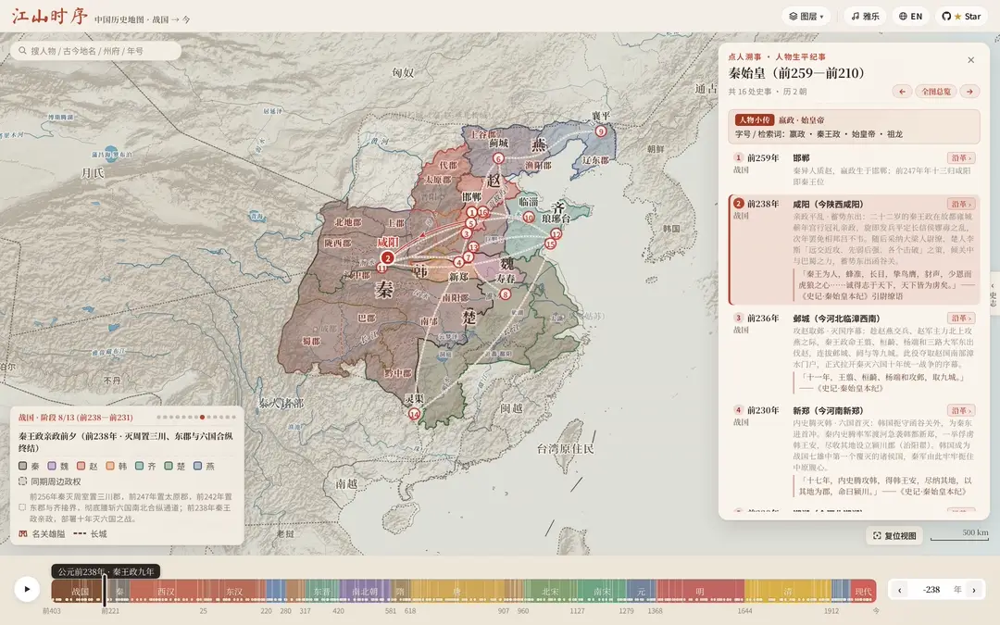
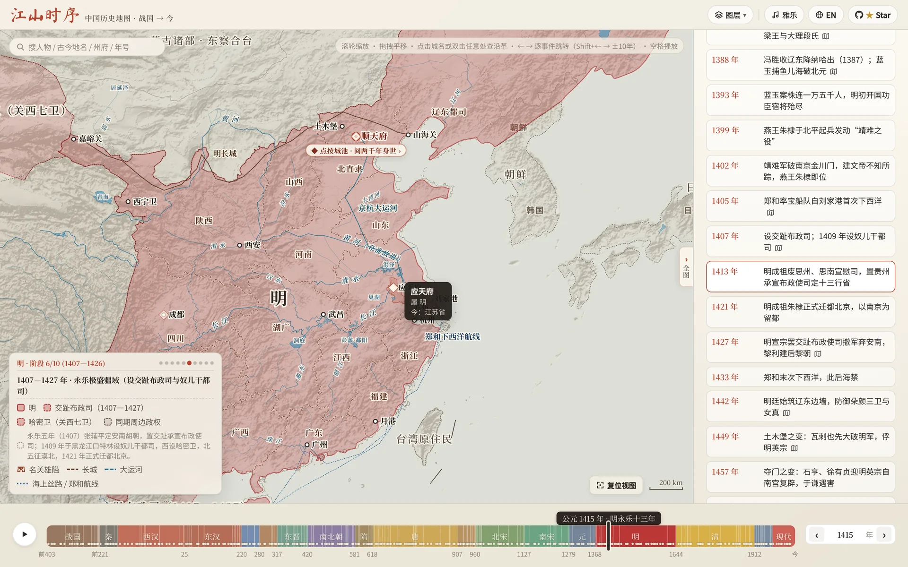
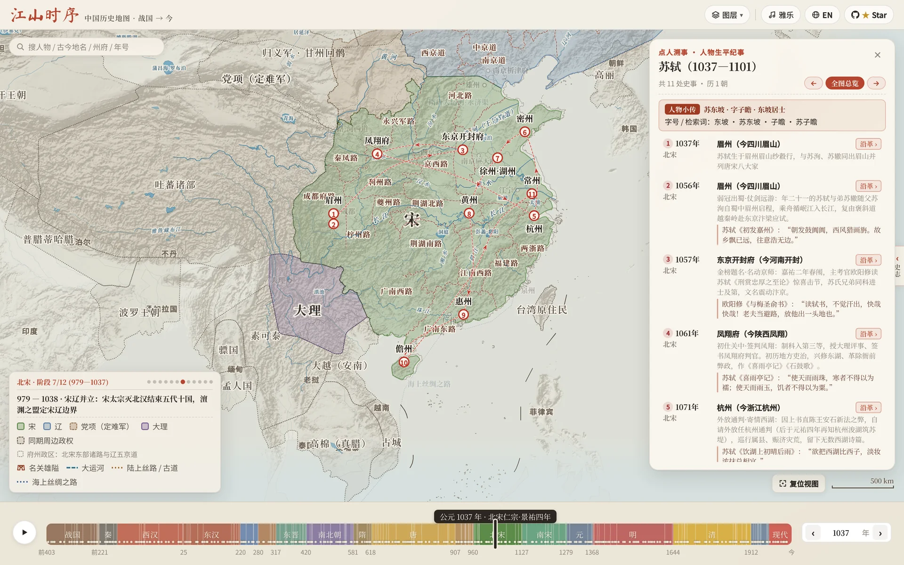

# 江山时序 · Chronicles of the Realm

<p align="left">
  <a href="README.md">English</a> · <strong>简体中文</strong>
</p>

**一幅可以拖动时间、点城读史、追随古人足迹的中国历史交互舆图（公元前 403 年三家分晋 — 今）**

[**立即在线把玩 → https://deanchen.me/jiangshan-map/**](https://deanchen.me/jiangshan-map/)

*作者自述：[从历史课本里的插图，到 GitHub 1k star：「江山时序」背后的故事](https://deanchen.me/history/atlas/2026/10/25/jiangshan-map-story.html)*

<p align="center">
  <a href="https://deanchen.me/jiangshan-map/">
    
  </a>
</p>

---

## 这幅地图好玩在哪里？

读史书、背古诗词时，你是否也常有这样的困惑：
- *「六朝古都建康、苏东坡被贬的黄州、韩愈勒马的秦岭蓝关、岳飞北伐的朱仙镇，放在今天的地图上到底在哪儿？」*
- *「长安在两千年里换过多少个名字？这片土地上先后发生过多少场改写国运的大事？」*
- *「《资治通鉴》开篇的三家分晋与战国七雄、秦王嬴政十年扫六合、汉武帝打通河西走廊、盛唐安西四镇与王玄策破中天竺、元代设宣政院辖西藏、晚清曾纪泽收复伊犁，再到近现代版图从『秋海棠』变为『雄鸡』，疆域是怎么一步步演变的？」*

**「江山时序」** 把从公元前 403 年（《资治通鉴》开篇 · 三家分晋）至今 **两千四百余年**、**18 个历史时期**的**多阶段疆域与州郡政区舆图**、**历代古城**、**天下名关**、**诗词名胜与古战场**、**编年大事**及**帝王年号纪年**装进了一张宣纸设色古舆图里。你不需要翻检厚重的历史地图册，只需拖动滑块、点点城池，就能在时空之间自由穿梭。

---

### 玩法一：拉动时间轴看天下分合、查在位帝王、比古今省界

- **同屏看多政权对峙**：从战国七雄（秦、楚、齐、燕、赵、魏、韩）与周、越、巴蜀、中山、义渠并立，到汉末三国群雄割据（袁绍、曹操、刘备、孙权、公孙氏辽东），再到南北朝、五代十国与宋、辽、西夏、大理、金、蒙古，都以高对比度宣纸设色同屏呈现。鼠标移到左下角图例的政权名字上，对应政权立刻高亮；点一下直接聚焦过去。
- **多阶段疆域演进与「虚线残影」对比**：每一个重大开疆或失地节点——如前 316 年司马错灭巴蜀、前 300 年燕将秦开破东胡辟辽东五郡、43 年马援平交趾立铜柱、238 年司马懿平公孙渊收辽东、635 年李靖平吐谷浑、648 年置安西四镇与王玄策破中天竺、1288 年元设宣政院直辖西藏、1404 年明置哈密卫与关西七卫、1643 年大顺大西起兵、1673 年三藩之乱、1881 年曾纪泽签《中俄伊犁条约》收复伊犁、1898 年列强强租胶州湾/旅大/威海卫/九龙新界，乃至 1945 年抗战胜利台湾光复（“秋海棠”重光）与 1946 年外蒙古独立（版图由**“秋海棠”变为“雄鸡”**）——点击编年事件或阶段圆点，版图即刻切换并浮现上一阶段的朱砂虚线残影，盈亏得失一目了然。
- **当朝在位帝王与年号同步显示**：时间轴实时内联展示当年在位君主（庙号 / 谥号 + 姓名 + 在位起止年，如 `汉武帝 刘彻`、`唐太宗 李世民`、`清圣祖 玄烨`）及历代年号纪年。
- **历代州府悬停即查 & 古今透视镜**：一级政区采用拓扑去重与宣纸衬底双重描边（Parchment Casing）；放大地图悬停任意州郡（如明代的「应天府」「顺天府」、三国的「荆州」）即可查看政区归属与今省对照，还可打开 **「透视镜」** 在古舆图上直接投射现代省界。
- **水系古泽与千年工程随年代流转**：拉动时间轴时，黄河历代改道、云梦泽与罗布泊（蒲昌海）等古湖消长，以及战国秦汉明长城、隋唐与京杭大运河、丝绸之路、郑和航线均随当朝版图同步演进。

> [点击直达：大明永乐十三年（1415 年）· 两京十三布政使司与「应天府」府境探查 →](https://deanchen.me/jiangshan-map/?year=1415&zoom=1.75&center=115.8,33.2&hover=%E5%BA%94%E5%A4%A9%E5%BA%9C)



---

### 玩法二：点开任意一座城或名关，读它两千四百年的身世与风云

在地图上**直接点击任意古城、名关**（或者双击地图任意位置），就会展开一张 **「点地溯源」** 卡片：
- **名城风华题记与古今政区沿革**：卡片顶部呈现该城专属的**名城判词与千年历史小传**；下方沿革表从战国七雄与秦朝的郡、汉朝的刺史部、唐朝的道、宋朝的路，一路看到元明清的行省与府州，直至现代省市；哪几个朝代曾在此建都（`王朝都城` 徽章）与各朝代治所掌故一目了然。
- **看这里发生过什么大事**：每个朝代行下方直接内嵌当年发生在此地的**定点地标大事**（如咸阳的「商鞅变法」「秦王扫六合」、樊城的「关羽水淹七军」、长安的「玄武门之变」、临安的「风波亭岳飞蒙难」）。点一下右上角的 **「史事纪要」** 胶囊，还能一键筛出有大事发生的朝代；点击任意一条事件，时间轴和地图版图立即穿越回那一年！
- **探访天下名关与诗词名胜**：地图以专属汉阙城楼图标标出函谷关、潼关、剑门关、雁门关、玉门关、阳关、山海关等**天下雄关**（附山脉水系扼守形势详解），并收录赤壁、垓下、五丈原、兰亭、岳阳楼、滕王阁、蓝关、楼兰、蒲昌海（罗布泊）、热海（伊塞克湖）等**诗词名胜与古战场**，支持直接检索落针。

> [点击直达：盛唐开元二十九年（741 年）· 点开长安看千年风云 →](https://deanchen.me/jiangshan-map/?year=741&place=长安)


---

### 玩法三：点人溯事 —— 搜任意帝王将相与文豪名僧，重走万里青史路

点开左上角 **万能搜索框**（附单条可轮换人物示例与 `长安 / 赤壁 / 贞观 / 霍去病` 快捷检索词，亦可直接输入 `曹操`、`司马迁`、`岳飞`、`郑和` 等任意历史人物），即可展开 **「点人溯事」** 生平纪事面板，在山河版图上以古籍游丝弧线串起其一生行迹：
- **秦始皇一统六国行迹（前 238 — 前 221 年）**：从咸阳亲政平乱、王翦攻赵邺城拉开序幕，到内史腾灭韩、王翦克邯郸灭赵、易水破燕拔蓟城、王贲水灌大梁灭魏、王翦六十万大军破楚、远征辽东灭燕平代，直至南下临淄齐王建出降、六国一统——每点下一处史事，地图上的韩、赵、魏、楚、燕、齐便随之一步步并入大秦版图！
- **张骞凿空西域行迹（前 138 — 前 126 年）**：从长安出发，被匈奴羁留十余载不改其志，持汉节一路走到大宛、康居、大月氏。
- **诸葛亮出山北伐行迹（207 — 234 年）**：从襄阳隆中三顾茅庐、柴桑联吴破曹、溯江入蜀、白帝托孤、五月渡泸南征，到进驻汉中上《出师表》、祁山北伐与五丈原秋风星落。
- **玄奘西行求法行迹（627 — 645 年）**：孤身出玉门关，涉莫贺延碛、越凌山雪隘、渡印度河，抵那烂陀寺求法、赴曲女城讲论，载誉归唐。
- **李白仗剑壮游行迹（701 — 762 年）**：自安西碎叶入蜀居青莲，二十四岁仗剑出三峡、漫游扬州散金三十万、酒隐安陆、仰天大笑入长安供奉翰林、洛阳逢杜甫、白帝城遇赦放舟，终老当涂青山。
- **苏轼宦海贬谪行迹（1056 — 1101 年）**：从出川赴京、密州超然台赏月，到乌台诗案后贬谪黄州写下《赤壁赋》，再到惠州、跨海远谪海南儋州。
- **王阳明心学立功行迹（1472 — 1529 年）**：从余姚瑞云楼降生、京师抗疏下诏狱，到贬谪贵州修文「龙场悟道」始倡知行合一、庐陵讲学、巡抚南赣破山贼、三十五日生擒宁王朱宸濠、绍兴天泉证道揭出「致良知」，直至总督两广归途舟次南安留下「此心光明，亦复何言」。

每切换上一处 / 下一处史事（点击面板 **`‹ / ›`**、键盘方向键或按空格键自动演进），**底下的历史年份、在位君主与年号、王朝版图都会跟着古人的脚步同步流转**，单段朱砂飞白弧线精准高亮当前行程，并附有《史记》《出师表》《传习录》或唐宋千古名篇原句。

> [点击直达：展阅苏东坡宦海贬谪生平与行迹（1037 — 1101 年）→](https://deanchen.me/jiangshan-map/?person=sushi)



---

### 玩法四：彩蛋 · 舆图寻址挑战 —— 测测你在古代能当几品官？

觉得自己历史地理很熟？点开左上角 **搜索框** 引导栏右下角的 **「古地名小试 ›」**（或直接搜 `小试` / `寻址` 开启 **「舆图寻址 · 古地名小试」**）试试身手：
- **当朝掌故线索 + 舆图盲猜扎针**：地图隐去所有城池标注，十道题按梯度递进，给出「西汉时期的姑臧（凉州）」「南宋时期的泉州」或「六朝古都建康」，并附上**当朝掌故与史事线索**（不剧透现代城市名），凭你的山河水系直觉在舆图上落针预览、点击图钉内嵌的**「`✓ 确定`」**揭晓同心圆环距离得分！
- 十道题答完，系统会根据总分授予你 **「太史令 · 舆图大家」「职方郎中」「州郡从事」** 等传统官阶封号。

> [点击直达：西汉武帝元狩二年（前 121 年）· 开启「舆图寻址」挑战模式 →](https://deanchen.me/jiangshan-map/?year=-121&quiz=locate)


---

## 实用快捷键与任意门（Deep Links）

### 快捷键一览

| 操作 / 按键 | 作用 |
| :--- | :--- |
| **`/`** 或 **`Cmd/Ctrl + K`** | 唤醒左上角**万能搜索框**：支持搜**古今城池**（`咸阳`/`长安`/`洛邑`/`东京汴梁`）、**在位帝王**（`汉武帝`/`刘彻`/`李世民`/`朱元璋`）、**帝王年号**（`元狩二年`/`贞观`/`永乐`）、**诗词名胜与古战场**（`赤壁`/`五丈原`/`蓝关`/`兰亭`）、**天下名关**（`函谷关`/`剑门关`/`玉门关`）、**历史大事**（`长平之战`/`水淹七军`/`玄武门之变`）或**人物行迹** |
| **`←` / `→`** 或底部 **`‹ / ›`** | 键盘左右键与底部 **`‹ / ›`** 按钮直接跳往上 / 下一关键历史阶段、事件节点或行迹站点（按住 `Shift + ← / →` 进退 `10` 年） |
| **`Space`（空格键）** | 自动播放 / 暂停历史演进（行迹模式下自动巡礼） |
| **`Esc`** | 一键关闭弹窗卡片、清除搜索高亮或自定义多站路线 |
| **`单击古城` / `双击地图`** | 打开该地从战国到近现代的 18 时期「点地溯源 + 史事纪要」卡片 |
| **`悬停 / 点击图例色块`** | 悬停单独高亮该政权疆域；点击自动缩放聚焦至该政权 |

### 一键直达链接（适合分享给朋友）

你可以直接在网址后面加上参数，把某个特定的历史瞬间分享给朋友：
- **看某一年或重大疆域变迁**：[`?year=-403`](https://deanchen.me/jiangshan-map/?year=-403)（《资治通鉴》开篇 · 三家分晋） / [`?year=-121`](https://deanchen.me/jiangshan-map/?year=-121)（西汉霍去病开河西） / [`?year=648`](https://deanchen.me/jiangshan-map/?year=648)（唐置安西四镇与王玄策破中天竺） / [`?year=1288`](https://deanchen.me/jiangshan-map/?year=1288)（元改宣政院直辖西藏） / [`?year=1881`](https://deanchen.me/jiangshan-map/?year=1881)（曾纪泽签约收复伊犁） / [`?year=1945`](https://deanchen.me/jiangshan-map/?year=1945)（抗战胜利台湾光复 · “秋海棠”重光）
- **看某场大战**：[`?year=-260&place=长平`](https://deanchen.me/jiangshan-map/?year=-260&place=长平)（长平之战） / [`?year=208&place=赤壁`](https://deanchen.me/jiangshan-map/?year=208&place=赤壁)（赤壁之战） / [`?year=383&place=淝水`](https://deanchen.me/jiangshan-map/?year=383&place=淝水)（东晋前秦 · 淝水之战）
- **查某座古城或名胜的千年故事**：[`?year=741&place=长安`](https://deanchen.me/jiangshan-map/?year=741&place=长安)（长安/西安） / [`?year=1415&place=应天府`](https://deanchen.me/jiangshan-map/?year=1415&place=应天府)（建康/应天/南京） / [`?year=819&place=蓝关`](https://deanchen.me/jiangshan-map/?year=819&place=蓝关)（韩愈「雪拥蓝关马不前」）
- **画一条自定义诗词/行军路线**：[`?year=763&place=剑外,巴峡,巫峡,襄阳,洛阳`](https://deanchen.me/jiangshan-map/?year=763&place=剑外,巴峡,巫峡,襄阳,洛阳)（杜甫《闻官军收河南河北》同年归乡路） / [`?year=1079,1080,1094,1097&place=湖州,黄州,惠州,儋州`](https://deanchen.me/jiangshan-map/?year=1079,1080,1094,1097&place=湖州,黄州,惠州,儋州)（苏轼「黄州惠州儋州」跨年贬谪路）
- **展阅历史人物生平与行迹**：[`?person=qinshihuang`](https://deanchen.me/jiangshan-map/?person=qinshihuang)（秦始皇一统六国） / [`?person=zhangqian`](https://deanchen.me/jiangshan-map/?person=zhangqian)（张骞凿空西域） / [`?person=zhugeliang`](https://deanchen.me/jiangshan-map/?person=zhugeliang)（诸葛亮出山北伐） / [`?person=xuanzang`](https://deanchen.me/jiangshan-map/?person=xuanzang)（玄奘西行求法） / [`?person=libai`](https://deanchen.me/jiangshan-map/?person=libai)（李白仗剑壮游） / [`?person=sushi`](https://deanchen.me/jiangshan-map/?person=sushi)（苏轼宦海贬谪） / [`?person=wangyangming`](https://deanchen.me/jiangshan-map/?person=wangyangming)（王阳明心学立功）
- **直接开一局挑战**：[`?year=-121&quiz=locate`](https://deanchen.me/jiangshan-map/?year=-121&quiz=locate)（舆图寻址挑战）
- **切换繁简与英文界面**：[`?lang=zh-tw`](https://deanchen.me/jiangshan-map/?lang=zh-tw)（繁体中文） / [`?lang=en`](https://deanchen.me/jiangshan-map/?lang=en)（英文版）

---

## AI Agent、MCP & LLM 接入指南

「江山时序」原生支持作为大语言模型（LLM）、MCP 客户端与 AI Agent 的**历史地理可视化工具**。模型**无需猜测经纬度坐标**，只需从诗词或史料中提取 **`year`（年份）** 与 **`place`（古今地名）** 两个语义参数，地图即可自动完成地名解析、镜头聚焦、疆域政区渲染、轨迹连线与「点地溯源」卡片展开：

- **机器可读说明文档**：[`llms.txt`](llms.txt)
- **零依赖本地 MCP Server (`stdio`)**：[`scripts/mcp_server.js`](scripts/mcp_server.js) —— 可直接接入 Claude Desktop、Cursor、Windsurf 或 Gemini CLI 的 `mcpServers` 配置（0 第三方依赖，单次查询 `<5ms`）：
  ```json
  {
    "mcpServers": {
      "jiangshan-atlas": {
        "command": "node",
        "args": ["/absolute/path/to/jiangshan-map/scripts/mcp_server.js"]
      }
    }
  }
  ```
  原生提供 3 个 MCP 工具：
  - `inspect_place({ year, place, lang? })`：查询任意年份与古今地名/多站路线的在位君主年号、所属政权、州郡政区、现代省市、两千四百年沿革判词与可点击深链 URL。
  - `inspect_person({ person, stop?, lang? })`：查询历史人物或历代帝王的生平纪事时空落点与深链 URL。
  - `search_atlas({ query, limit?, lang? })`：跨全朝代检索古城、地标、名关、历史人物、帝王年号与编年大事。
- **开箱即用 Agent Skill**：[`skills/jiangshan-atlas/SKILL.md`](skills/jiangshan-atlas/SKILL.md)（含零依赖 CLI 渲染脚本 [`skills/jiangshan-atlas/scripts/jiangshan.py`](skills/jiangshan-atlas/scripts/jiangshan.py)）
  ```bash
  # 一键安装至 Claude Code / Gemini / Jetski 全局技能目录：
  mkdir -p ~/.claude/skills ~/.gemini/config/skills && cp -r skills/jiangshan-atlas ~/.claude/skills/ && cp -r skills/jiangshan-atlas ~/.gemini/config/skills/
  ```

### 1. 零坐标双参数 URL 协议（0D 单点 / 1D 同年路线 / 4D 跨年路线）

| 模式 | URL 格式示例 | 自动渲染效果 |
| :--- | :--- | :--- |
| **单点寻址 (0D)** | [`?year=819&place=蓝关`](https://deanchen.me/jiangshan-map/?year=819&place=蓝关)<br>*(韩愈「雪拥蓝关马不前」)* | 自动跳转至唐宪宗元和十四年（819 年），精准落针秦岭蓝田关，展开两千四百年政区沿革卡片 |
| **同年多站路线 (1D)** | [`?year=763&place=剑外,巴峡,巫峡,襄阳,洛阳`](https://deanchen.me/jiangshan-map/?year=763&place=剑外,巴峡,巫峡,襄阳,洛阳)<br>*(杜甫「即从巴峡穿巫峡，便下襄阳向洛阳」)* | 自动在 763 年唐代版图上绘制 `1` → `5` 朱砂弧线轨迹并自适应缩放视野，点击任意站点即可查看历代沿革 |
| **跨年多站路线 (4D)** | [`?year=1079,1080,1094,1097&place=湖州,黄州,惠州,儋州`](https://deanchen.me/jiangshan-map/?year=1079,1080,1094,1097&place=湖州,黄州,惠州,儋州)<br>*(苏轼「问汝平生功业，黄州惠州儋州」)* | `year[i]` 与 `place[i]` 一一对应，地图路标自动标注 **`湖州 (1079)` → `黄州 (1080)` → `惠州 (1094)` → `儋州 (1097)`**，点击任意站点即可同步切换至该年份版图 |

### 2. CLI 一键出图（供 Agent 工具调用）

```bash
# 单点诗境落针截图
python3 skills/jiangshan-atlas/scripts/jiangshan.py --year 819 --place 蓝关 --out /tmp/languan_819.png

# 同年多站轨迹截图
python3 skills/jiangshan-atlas/scripts/jiangshan.py --year 763 --place 剑外,巴峡,巫峡,襄阳,洛阳 --out /tmp/dufu_763.png

# 跨年多站轨迹截图
python3 skills/jiangshan-atlas/scripts/jiangshan.py --year 1079,1080,1094,1097 --place 湖州,黄州,惠州,儋州 --out /tmp/sushi_exile.png
```

### 3. 浏览器端 JavaScript API（`window.atlasAPI`）与浏览器内建 WebMCP（`navigator.modelContext`）

在浏览器自动化环境（Playwright）或支持 WebMCP 协议的 AI 浏览器（`navigator.modelContext`）中，页面会自动注册 `jiangshan_locate`、`jiangshan_inspect`、`jiangshan_open_person` 三个工具，并挂载 `window.atlasAPI`：
- `window.atlasAPI.locate({ year, place, zoom? })`：驱动地图跳转并渲染单点落针或跨年轨迹，同时返回结构化历史地理信息。
- `window.atlasAPI.inspect({ year, place, person?, stop? })`：只读查询指定时空点、多站路线或人物纪事的所属政权、州郡政区、现代省市、各站里程与标准分享链接。
- `window.atlasAPI.resolvePlace(place, year?)`：解析历代城池、天下名关、诗词名胜与古战场古今地名。
- `window.atlasAPI.openPerson(person, stop?)` & `window.atlasAPI.search(query)`：在地图上展开人物生平纪事或执行全局检索。

---

## 本地运行

项目为纯静态网页，无需安装任何依赖或构建工具，克隆后用任意静态服务器打开即可：

```bash
git clone https://github.com/DeanChensj/jiangshan-map.git
cd jiangshan-map
python3 -m http.server 8000
```

随后在浏览器打开 `http://localhost:8000`。

---

## GeoJSON 导出（供 Leaflet / MapLibre / QGIS 使用）

程序内置的几何数据是拓扑去重的 VLQ 紧凑编码。如需在其他项目中使用矢量图层，可在本地生成标准 RFC 7946 GeoJSON（EPSG:4326，经度/纬度），输出到 `geojson/`，不纳入版本库。导出范围为公元前 403 年至 1948 年，不含此后年份及现代省界图层：

```bash
node scripts/export_geojson.js            # 或：node scripts/export_geojson.js <输出目录>
```

- `snapshots/<id>.geojson`：每个疆域阶段一个文件；每个要素带 `bbox`，属性含 `layer`（`polity` 政权 / `region` 一级政区 / `prefecture` 州郡）、`title`、`title_en`、`category`、`tint`、`anchor`。
- `index.json`：各朝代阶段的起止年份 `from` / `to`（负数为公元前，无公元 0 年）及对应快照文件。
- `corridors.geojson`（长城、运河、道路、海路）、`settlements.geojson`、`milestones.geojson`、`neighbors.geojson`，以及 `modern/`（河流、湖泊、水系注记；`appear` / `vanish` 表示古河道与古湖泊显示的起止年份）。

按坐标查询时无需加载全部阶段：[`geojson/jiangshan-locate.js`](geojson/jiangshan-locate.js) 只加载 `index.json` 和覆盖该年份的那一个快照，再用包围盒预筛加点在多边形内判断。

```js
const atlas = JiangshanLocate.create(); // 或 create({ base: '<geojson/ 目录的 URL>' })
const hit = await atlas.locate(118.78, 32.06, 1415); // 经度, 纬度, 年份
hit.polity.properties.title;     // 明
hit.region.properties.title;     // 南直隶
hit.prefecture.properties.title; // 应天府（本身是 GeoJSON Feature，可直接 L.geoJSON(hit.prefecture)）
```

导出后启动本地服务（`python3 -m http.server 8000`），打开 `http://localhost:8000/geojson/demo.html` 即可查看 Leaflet 示例：拖动年份滑块、点击地图，或打开 `demo.html?year=1415&lon=118.78&lat=32.06` 自动加载、高亮并缩放到该处。数据采用 GPL-3.0 协议，历史疆域为示意性近似。

---

## 致谢与开源协议

- **历史疆域与政区参考**：谭其骧主编《中国历史地图集》、**CHGIS**（哈佛燕京学社与复旦大学中国历史地理信息系统）、**Robert M. Hartwell** 历史 GIS 数据集，以及 [aourednik/historical-basemaps](https://github.com/aourednik/historical-basemaps)（GPL-3.0）。
- **现代省界参考**：DataV GeoAtlas 开放行政边界数据。
- **古琴雅乐录音**：Wikimedia Commons 公有领域古琴录音（《流水》《平沙落雁》《阳关三叠》《醉渔唱晚》《酒狂》）。
- **说明**：地图中的历史疆域轮廓与州郡政区边界为示意性近似，旨在直观呈现各时期大致统治与管辖范围，非精确现代测绘边界。
- **参与贡献**：参见 [中文贡献指南 (`CONTRIBUTING_ZH.md`)](CONTRIBUTING_ZH.md)（[English Contributing Guide](CONTRIBUTING.md)）了解项目结构、史料校勘规范与自动化校验流程。
- **开源协议**：采用 **GPL-3.0**（见 [LICENSE](LICENSE)）。Copyright © 2026 DeanChensj。
  - **例外**：源自 CHGIS V6 与 Hartwell China Historical GIS 的府州郡政区边界及战国疆域数据，仍受其原始条款约束（仅限学术、非商业用途），不适用 GPL-3.0。
