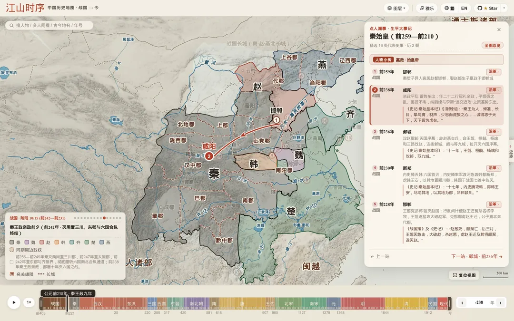
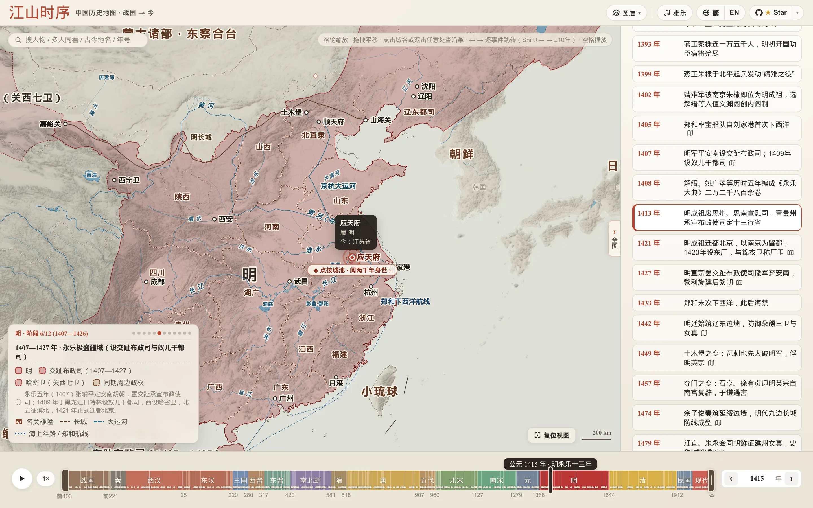
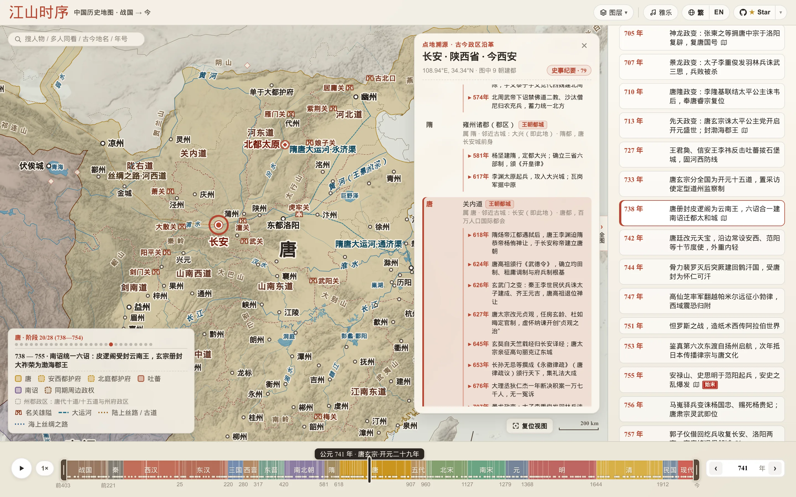
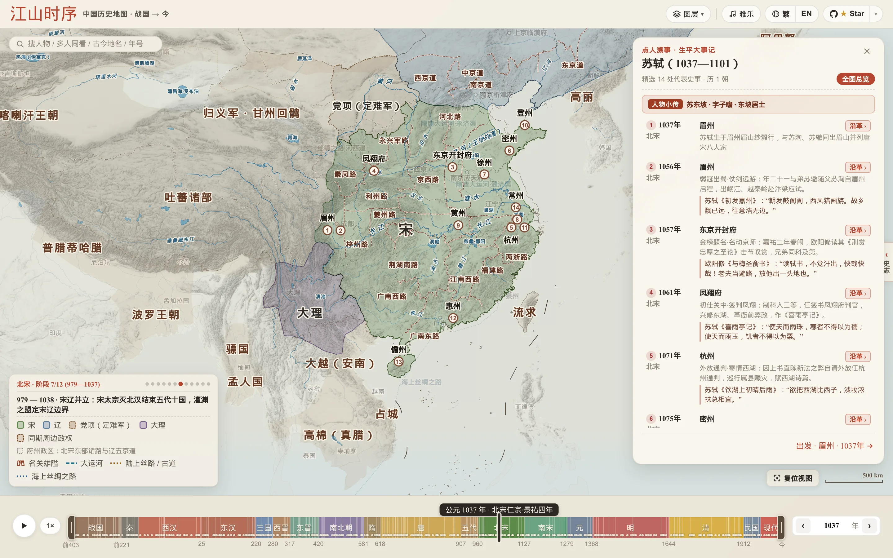
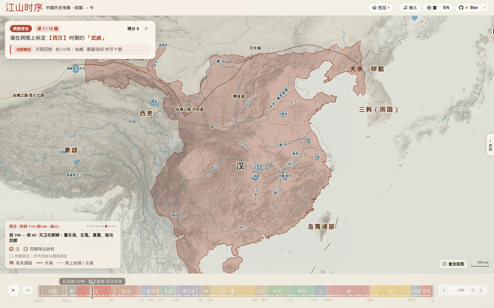

# 江山時序 · Chronicles of the Realm

<p align="left">
  <a href="README.md">English</a> · <a href="README_ZH.md">简体中文</a> · <strong>繁體中文</strong> · <a href="README_JA.md">日本語</a>
</p>

**一幅可以拖動時間、點城讀史、追隨古人足跡的中國歷史互動輿圖（西元前 403 年三家分晉 — 今）**

[**立即線上把玩（繁體介面）→ https://deanchen.me/jiangshan-map/?lang=zh-tw**](https://deanchen.me/jiangshan-map/?lang=zh-tw)

> 本文件為 [簡體中文 README](README_ZH.md) 的繁體中文（臺灣）譯本；專有名詞與用語的校訂原則見 [繁體化工作日誌](docs/zh-hant-worklog.md)。

*作者自述：[從歷史課本裡的插圖，到 GitHub 1k star：「江山時序」背後的故事](https://deanchen.me/history/atlas/2026/10/25/jiangshan-map-story.html)*

<p align="center">
  <a href="https://www.star-history.com/deanchensj/jiangshan-map">
    <picture>
      <source media="(prefers-color-scheme: dark)" srcset="https://api.star-history.com/badge?repo=deanchensj/jiangshan-map&type=trending&theme=dark" />
      <source media="(prefers-color-scheme: light)" srcset="https://api.star-history.com/badge?repo=deanchensj/jiangshan-map&type=trending" />
      
    </picture>
  </a>
</p>

<p align="center">
  <a href="https://deanchen.me/jiangshan-map/">
    
  </a>
</p>

---

## 這幅地圖好玩在哪裡？

讀史書、背古詩詞時，你是否也常有這樣的困惑：
- *「六朝古都建康、蘇東坡被貶的黃州、韓愈勒馬的秦嶺藍關、岳飛北伐的朱仙鎮，放在今天的地圖上到底在哪兒？」*
- *「長安在兩千年裡換過多少個名字？這片土地上先後發生過多少場改寫國運的大事？」*
- *「《資治通鑑》開篇的三家分晉與戰國七雄、秦王嬴政十年掃六合、漢武帝打通河西走廊、盛唐安西四鎮與王玄策破中天竺、元代設宣政院轄西藏、晚清曾紀澤收復伊犁，再到近現代版圖從『秋海棠』變為『雄雞』，疆域是怎麼一步步演變的？」*

**「江山時序」** 把從西元前 403 年（《資治通鑑》開篇 · 三家分晉）至今 **兩千四百餘年**、**18 個歷史時期**的**多階段疆域與州郡政區輿圖**、**歷代古城**、**天下名關**、**詩詞名勝與古戰場**、**編年大事**及**帝王年號紀年**裝進了一張宣紙設色古輿圖裡。你不需要翻檢厚重的歷史地圖冊，只需拖動滑塊、點點城池，就能在時空之間自由穿梭。

---

### 玩法一：拉動時間軸看天下分合、查在位帝王、比古今省界

- **同屏看多政權對峙**：從戰國七雄（秦、楚、齊、燕、趙、魏、韓）與周、越、巴蜀、中山、義渠並立，到漢末三國群雄割據（袁紹、曹操、劉備、孫權、公孫氏遼東），再到南北朝、五代十國與宋、遼、西夏、大理、金、蒙古，都以高對比度宣紙設色同屏呈現。滑鼠移到左下角圖例的政權名字上，對應政權立刻高亮；點一下直接聚焦過去。
- **多階段疆域演進與「虛線殘影」對比**：每一個重大開疆或失地節點——如前 316 年司馬錯滅巴蜀、前 300 年燕將秦開破東胡闢遼東五郡、43 年馬援平交趾立銅柱、238 年司馬懿平公孫淵收遼東、635 年李靖平吐谷渾、648 年置安西四鎮與王玄策破中天竺、1288 年元設宣政院直轄西藏、1404 年明置哈密衛與關西七衛、1643 年大順大西起兵、1673 年三藩之亂、1881 年曾紀澤簽《中俄伊犁條約》收復伊犁、1898 年列強強租膠州灣/旅大/威海衛/九龍新界，乃至 1945 年抗戰勝利臺灣光復（“秋海棠”重光）與 1946 年外蒙古獨立（版圖由**“秋海棠”變為“雄雞”**）——點選編年事件或階段圓點，版圖即刻切換並浮現上一階段的朱砂虛線殘影，盈虧得失一目了然。
- **當朝在位帝王與年號同步顯示**：時間軸即時內嵌顯示當年在位君主（廟號 / 諡號 + 姓名 + 在位起止年，如 `漢武帝 劉徹`、`唐太宗 李世民`、`清聖祖 玄燁`）及歷代年號紀年。
- **歷代州府懸停即查 & 古今透視鏡**：一級政區採用拓撲去重與宣紙襯底雙重描邊（Parchment Casing）；放大地圖懸停任意州郡（如明代的「應天府」「順天府」、三國的「荊州」）即可查看政區歸屬與今省對照，還可開啟 **「透視鏡」** 在古輿圖上直接投射現代省界。
- **水系古澤與千年工程隨年代流轉**：拉動時間軸時，黃河歷代改道、雲夢澤與羅布泊（蒲昌海）等古湖消長，以及戰國秦漢明長城、隋唐與京杭大運河、絲綢之路、鄭和航線均隨當朝版圖同步演進。

> [點選直達：大明永樂十三年（1415 年）· 兩京十三布政使司與「應天府」府境探查 →](https://deanchen.me/jiangshan-map/?year=1415&zoom=1.75&center=115.8,33.2&hover=%E5%BA%94%E5%A4%A9%E5%BA%9C)



---

### 玩法二：點開任意一座城或名關，讀它兩千四百年的身世與風雲

在地圖上**直接點選任意古城、名關**（或者雙擊地圖任意位置），就會展開一張 **「點地溯源」** 卡片：
- **名城風華題記與古今政區沿革**：卡片頂部呈現該城專屬的**名城判詞與千年歷史小傳**；下方沿革表從戰國七雄與秦朝的郡、漢朝的刺史部、唐朝的道、宋朝的路，一路看到元明清的行省與府州，直至現代省市；哪幾個朝代曾在此建都（`王朝都城` 徽章）與各朝代治所掌故一目了然。
- **看這裡發生過什麼大事**：每個朝代行下方直接內嵌當年發生在此地的**定點地標大事**（如咸陽的「商鞅變法」「秦王掃六合」、樊城的「關羽水淹七軍」、長安的「玄武門之變」、臨安的「風波亭岳飛蒙難」）。點一下右上角的 **「史事紀要」** 膠囊，還能一鍵篩出有大事發生的朝代；點選任意一條事件，時間軸和地圖版圖立即穿越回那一年！
- **探訪天下名關與詩詞名勝**：地圖以專屬漢闕城樓圖示標出函谷關、潼關、劍門關、雁門關、玉門關、陽關、山海關等**天下雄關**（附山脈水系扼守形勢詳解），並收錄赤壁、垓下、五丈原、蘭亭、岳陽樓、滕王閣、藍關、樓蘭、蒲昌海（羅布泊）、熱海（伊塞克湖）等**詩詞名勝與古戰場**，支援直接檢索落針。

> [點選直達：盛唐開元二十九年（741 年）· 點開長安看千年風雲 →](https://deanchen.me/jiangshan-map/?year=741&place=長安)



---

### 玩法三：點人溯事 —— 搜任意帝王將相與文豪名僧，重走萬里青史路

點開左上角 **萬能搜尋框**（附單條可輪換人物範例與 `長安 / 赤壁 / 貞觀 / 霍去病` 快捷檢索詞，亦可直接輸入 `曹操`、`司馬遷`、`岳飛`、`鄭和` 等任意歷史人物），即可展開 **「點人溯事」** 生平紀事面板，在山河版圖上以古籍遊絲弧線串起其一生行跡：
- **秦始皇一統六國行跡（前 238 — 前 221 年）**：從咸陽親政平亂、王翦攻趙鄴城拉開序幕，到內史騰滅韓、王翦克邯鄲滅趙、易水破燕拔薊城、王賁水灌大梁滅魏、王翦六十萬大軍破楚、遠征遼東滅燕平代，直至南下臨淄齊王建出降、六國一統——每點下一處史事，地圖上的韓、趙、魏、楚、燕、齊便隨之一步步併入大秦版圖！
- **張騫鑿空西域行跡（前 138 — 前 126 年）**：從長安出發，被匈奴羈留十餘載不改其志，持漢節一路走到大宛、康居、大月氏。
- **諸葛亮出山北伐行跡（207 — 234 年）**：從襄陽隆中三顧茅廬、柴桑聯吳破曹、溯江入蜀、白帝託孤、五月渡瀘南征，到進駐漢中上《出師表》、祁山北伐與五丈原秋風星落。
- **玄奘西行求法行跡（627 — 645 年）**：孤身出玉門關，涉莫賀延磧、越凌山雪隘、渡印度河，抵那爛陀寺求法、赴曲女城講論，載譽歸唐。
- **李白仗劍壯遊行跡（701 — 762 年）**：自安西碎葉入蜀居青蓮，二十四歲仗劍出三峽、漫遊揚州散金三十萬、酒隱安陸、仰天大笑入長安供奉翰林、洛陽逢杜甫、白帝城遇赦放舟，終老當塗青山。
- **蘇軾宦海貶謫行跡（1056 — 1101 年）**：從出川赴京、密州超然臺賞月，到烏臺詩案後貶謫黃州寫下《赤壁賦》，再到惠州、跨海遠謫海南儋州。
- **王陽明心學立功行跡（1472 — 1529 年）**：從餘姚瑞雲樓降生、京師抗疏下詔獄，到貶謫貴州修文「龍場悟道」始倡知行合一、廬陵講學、巡撫南贛破山賊、三十五日生擒寧王朱宸濠、紹興天泉證道揭出「致良知」，直至總督兩廣歸途舟次南安留下「此心光明，亦復何言」。

每切換上一處 / 下一處史事（點選面板 **`‹ / ›`**、鍵盤方向鍵或按空白鍵自動演進），**底下的歷史年份、在位君主與年號、王朝版圖都會跟著古人的腳步同步流轉**，單段朱砂飛白弧線精準高亮當前行程，並附有《史記》《出師表》《傳習錄》或唐宋千古名篇原句。

> [點選直達：展閱蘇東坡宦海貶謫生平與行跡（1037 — 1101 年）→](https://deanchen.me/jiangshan-map/?person=sushi)



---

### 玩法四：彩蛋 · 輿圖尋址挑戰 —— 測測你在古代能當幾品官？

覺得自己歷史地理很熟？點開左上角 **搜尋框** 引導欄右下角的 **「古地名小試 ›」**（或直接搜 `小試` / `尋址` 開啟 **「輿圖尋址 · 古地名小試」**）試試身手：
- **當朝掌故線索 + 輿圖盲猜扎針**：地圖隱去所有城池標註，十道題按梯度遞進，給出「西漢時期的姑臧（涼州）」「南宋時期的泉州」或「六朝古都建康」，並附上**當朝掌故與史事線索**（不劇透現代城市名），憑你的山河水系直覺在輿圖上落針預覽、點選圖釘內嵌的**「`✓ 確定`」**揭曉同心圓環距離得分！
- 十道題答完，系統會根據總分授予你 **「太史令 · 輿圖大家」「職方郎中」「州郡從事」** 等傳統官階封號。

> [點選直達：西漢武帝元狩二年（前 121 年）· 開啟「輿圖尋址」挑戰模式 →](https://deanchen.me/jiangshan-map/?year=-121&quiz=locate)



---

## 實用快捷鍵與任意門（Deep Links）

### 快捷鍵一覽

| 操作 / 按鍵 | 作用 |
| :--- | :--- |
| **`/`** 或 **`Cmd/Ctrl + K`** | 喚醒左上角**萬能搜尋框**：支援搜**古今城池**（`咸陽`/`長安`/`洛邑`/`東京汴梁`）、**在位帝王**（`漢武帝`/`劉徹`/`李世民`/`朱元璋`）、**帝王年號**（`元狩二年`/`貞觀`/`永樂`）、**詩詞名勝與古戰場**（`赤壁`/`五丈原`/`藍關`/`蘭亭`）、**天下名關**（`函谷關`/`劍門關`/`玉門關`）、**歷史大事**（`長平之戰`/`水淹七軍`/`玄武門之變`）或**人物行跡** |
| **`←` / `→`** 或底部 **`‹ / ›`** | 鍵盤左右鍵與底部 **`‹ / ›`** 按鈕直接跳往上 / 下一關鍵歷史階段、事件節點或行跡站點（按住 `Shift + ← / →` 進退 `10` 年） |
| **`Space`（空白鍵）** | 自動播放 / 暫停歷史演進（行跡模式下自動巡禮） |
| **`Esc`** | 一鍵關閉彈窗卡片、清除搜尋高亮或自訂多站路線 |
| **`單擊古城` / `雙擊地圖`** | 開啟該地從戰國到近現代的 18 時期「點地溯源 + 史事紀要」卡片 |
| **`懸停 / 點選圖例色塊`** | 懸停單獨高亮該政權疆域；點選自動縮放聚焦至該政權 |

### 一鍵直達連結（適合分享給朋友）

你可以直接在網址後面加上參數，把某個特定的歷史瞬間分享給朋友：
- **看某一年或重大疆域變遷**：[`?year=-403`](https://deanchen.me/jiangshan-map/?year=-403)（《資治通鑑》開篇 · 三家分晉） / [`?year=-121`](https://deanchen.me/jiangshan-map/?year=-121)（西漢霍去病開河西） / [`?year=648`](https://deanchen.me/jiangshan-map/?year=648)（唐置安西四鎮與王玄策破中天竺） / [`?year=1288`](https://deanchen.me/jiangshan-map/?year=1288)（元改宣政院直轄西藏） / [`?year=1881`](https://deanchen.me/jiangshan-map/?year=1881)（曾紀澤簽約收復伊犁） / [`?year=1945`](https://deanchen.me/jiangshan-map/?year=1945)（抗戰勝利臺灣光復 · “秋海棠”重光）
- **看某場大戰**：[`?year=-260&place=長平`](https://deanchen.me/jiangshan-map/?year=-260&place=長平)（長平之戰） / [`?year=208&place=赤壁`](https://deanchen.me/jiangshan-map/?year=208&place=赤壁)（赤壁之戰） / [`?year=383&place=淝水`](https://deanchen.me/jiangshan-map/?year=383&place=淝水)（東晉前秦 · 淝水之戰）
- **查某座古城或名勝的千年故事**：[`?year=741&place=長安`](https://deanchen.me/jiangshan-map/?year=741&place=長安)（長安/西安） / [`?year=1415&place=應天府`](https://deanchen.me/jiangshan-map/?year=1415&place=應天府)（建康/應天/南京） / [`?year=819&place=藍關`](https://deanchen.me/jiangshan-map/?year=819&place=藍關)（韓愈「雪擁藍關馬不前」）
- **畫一條自訂詩詞/行軍路線**：[`?year=763&place=劍外,巴峽,巫峽,襄陽,洛陽`](https://deanchen.me/jiangshan-map/?year=763&place=劍外,巴峽,巫峽,襄陽,洛陽)（杜甫《聞官軍收河南河北》同年歸鄉路） / [`?year=1079,1080,1094,1097&place=湖州,黃州,惠州,儋州`](https://deanchen.me/jiangshan-map/?year=1079,1080,1094,1097&place=湖州,黃州,惠州,儋州)（蘇軾「黃州惠州儋州」跨年貶謫路）
- **展閱歷史人物生平與行跡**：[`?person=qinshihuang`](https://deanchen.me/jiangshan-map/?person=qinshihuang)（秦始皇一統六國） / [`?person=zhangqian`](https://deanchen.me/jiangshan-map/?person=zhangqian)（張騫鑿空西域） / [`?person=zhugeliang`](https://deanchen.me/jiangshan-map/?person=zhugeliang)（諸葛亮出山北伐） / [`?person=xuanzang`](https://deanchen.me/jiangshan-map/?person=xuanzang)（玄奘西行求法） / [`?person=libai`](https://deanchen.me/jiangshan-map/?person=libai)（李白仗劍壯遊） / [`?person=sushi`](https://deanchen.me/jiangshan-map/?person=sushi)（蘇軾宦海貶謫） / [`?person=wangyangming`](https://deanchen.me/jiangshan-map/?person=wangyangming)（王陽明心學立功）
- **直接開一局挑戰**：[`?year=-121&quiz=locate`](https://deanchen.me/jiangshan-map/?year=-121&quiz=locate)（輿圖尋址挑戰）
- **切換繁簡與英文介面**：[`?lang=zh-tw`](https://deanchen.me/jiangshan-map/?lang=zh-tw)（繁體中文） / [`?lang=en`](https://deanchen.me/jiangshan-map/?lang=en)（英文版）

### 嵌入到你的網頁

把地圖的任意畫面放進網誌文章、Notion 頁面或課程網站：

1. 開啟江山時序，調到你想展示的畫面（某一年、某個政權檔案、某個地點卡片或某個人物的軌跡）。網址列會即時反映當前畫面。
2. 複製網址，在後面加上 `&embed=1`。
3. 放進 `<iframe>`：

```html
<iframe
  src="https://deanchen.me/jiangshan-map/?embed=1&year=1104&trace=101.778,36.617&from=1072&to=1126"
  width="100%" height="480" loading="lazy" style="border:0"
  title="江山時序 · 西元1104年 北宋"></iframe>
```

嵌入後的地圖會隱藏網站的導覽列和側欄，只保留地圖、精簡時間軸、左上角的標題牌、右上角的「在江山時序中開啟 ↗」連結，以及「歷史疆域為示意性近似」的說明。讀者需要先點一下地圖才能拖動和縮放，捲動文章時不會被地圖卡住。

| 參數 | 作用 |
|---|---|
| `embed=1` | 開啟嵌入模式（必填） |
| `year`、`polity`、`person`、`stop`、`trace`、`lang` | 和上面的分享連結相同 |
| `from=1072&to=1126` | 把時間軸限定在這個範圍，時間軸會放大到只顯示這一段 |
| `lock=1` | 把地圖固定在 `year` 指定的年份，並隱藏時間軸 |
| `autoplay=1` | 自動逐站播放人物軌跡（配合 `person`），或自動播放時間軸 |

微信公眾號、知乎、小紅書不支援網頁嵌入，在這些平臺請直接分享連結。

---

## AI Agent、MCP & LLM 接入指南

「江山時序」原生支援作為大語言模型（LLM）、MCP 客戶端與 AI Agent 的**歷史地理視覺化工具**。模型**無需猜測經緯度座標**，只需從詩詞或史料中提取 **`year`（年份）** 與 **`place`（古今地名）** 兩個語義參數，地圖即可自動完成地名解析、鏡頭聚焦、疆域政區渲染、軌跡連線與「點地溯源」卡片展開：

- **機器可讀說明文件**：[`llms.txt`](llms.txt)
- **零相依本機 MCP Server (`stdio`)**：[`scripts/mcp_server.js`](scripts/mcp_server.js) —— 可直接接入 Claude Desktop、Cursor、Windsurf 或 Gemini CLI 的 `mcpServers` 設定（0 第三方相依套件，單次查詢 `<5ms`）：
  ```json
  {
    "mcpServers": {
      "jiangshan-atlas": {
        "command": "node",
        "args": ["/absolute/path/to/jiangshan-map/scripts/mcp_server.js"]
      }
    }
  }
  ```
  原生提供 3 個 MCP 工具：
  - `inspect_place({ year, place, lang? })`：查詢任意年份與古今地名/多站路線的在位君主年號、所屬政權、州郡政區、現代省市、兩千四百年沿革判詞與可點選深層連結 URL。
  - `inspect_person({ person, stop?, lang? })`：查詢歷史人物或歷代帝王的生平紀事時空落點與深層連結 URL。
  - `search_atlas({ query, limit?, lang? })`：跨全朝代檢索古城、地標、名關、歷史人物、帝王年號與編年大事。
- **開箱即用 Agent Skill**：[`skills/jiangshan-atlas/SKILL.md`](skills/jiangshan-atlas/SKILL.md)（含零相依 CLI 渲染腳本 [`skills/jiangshan-atlas/scripts/jiangshan.py`](skills/jiangshan-atlas/scripts/jiangshan.py)）
  ```bash
  # 一鍵安裝至 Claude Code / Gemini / Jetski 全域技能目錄：
  mkdir -p ~/.claude/skills ~/.gemini/config/skills && cp -r skills/jiangshan-atlas ~/.claude/skills/ && cp -r skills/jiangshan-atlas ~/.gemini/config/skills/
  ```

### 1. 零座標雙參數 URL 協議（0D 單點 / 1D 同年路線 / 4D 跨年路線）

| 模式 | URL 格式範例 | 自動渲染效果 |
| :--- | :--- | :--- |
| **單點尋址 (0D)** | [`?year=819&place=藍關`](https://deanchen.me/jiangshan-map/?year=819&place=藍關)<br>*(韓愈「雪擁藍關馬不前」)* | 自動跳轉至唐憲宗元和十四年（819 年），精準落針秦嶺藍田關，展開兩千四百年政區沿革卡片 |
| **同年多站路線 (1D)** | [`?year=763&place=劍外,巴峽,巫峽,襄陽,洛陽`](https://deanchen.me/jiangshan-map/?year=763&place=劍外,巴峽,巫峽,襄陽,洛陽)<br>*(杜甫「即從巴峽穿巫峽，便下襄陽向洛陽」)* | 自動在 763 年唐代版圖上繪製 `1` → `5` 朱砂弧線軌跡並自適應縮放視野，點選任意站點即可查看歷代沿革 |
| **跨年多站路線 (4D)** | [`?year=1079,1080,1094,1097&place=湖州,黃州,惠州,儋州`](https://deanchen.me/jiangshan-map/?year=1079,1080,1094,1097&place=湖州,黃州,惠州,儋州)<br>*(蘇軾「問汝平生功業，黃州惠州儋州」)* | `year[i]` 與 `place[i]` 一一對應，地圖路標自動標註 **`湖州 (1079)` → `黃州 (1080)` → `惠州 (1094)` → `儋州 (1097)`**，點選任意站點即可同步切換至該年份版圖 |

### 2. CLI 一鍵出圖（供 Agent 工具呼叫）

```bash
# 單點詩境落針截圖
python3 skills/jiangshan-atlas/scripts/jiangshan.py --year 819 --place 藍關 --out /tmp/languan_819.png

# 同年多站軌跡截圖
python3 skills/jiangshan-atlas/scripts/jiangshan.py --year 763 --place 劍外,巴峽,巫峽,襄陽,洛陽 --out /tmp/dufu_763.png

# 跨年多站軌跡截圖
python3 skills/jiangshan-atlas/scripts/jiangshan.py --year 1079,1080,1094,1097 --place 湖州,黃州,惠州,儋州 --out /tmp/sushi_exile.png
```

### 3. 瀏覽器端 JavaScript API（`window.atlasAPI`）與瀏覽器內建 WebMCP（`navigator.modelContext`）

在瀏覽器自動化環境（Playwright）或支援 WebMCP 協議的 AI 瀏覽器（`navigator.modelContext`）中，頁面會自動註冊 `jiangshan_locate`、`jiangshan_inspect`、`jiangshan_open_person` 三個工具，並掛載 `window.atlasAPI`：
- `window.atlasAPI.locate({ year, place, zoom? })`：驅動地圖跳轉並渲染單點落針或跨年軌跡，同時回傳結構化歷史地理資訊。
- `window.atlasAPI.inspect({ year, place, person?, stop? })`：唯讀查詢指定時空點、多站路線或人物紀事的所屬政權、州郡政區、現代省市、各站里程與標準分享連結。
- `window.atlasAPI.resolvePlace(place, year?)`：解析歷代城池、天下名關、詩詞名勝與古戰場古今地名。
- `window.atlasAPI.openPerson(person, stop?)` & `window.atlasAPI.search(query)`：在地圖上展開人物生平紀事或執行全域檢索。

---

## 本機執行

專案為純靜態網頁，無需安裝任何相依套件或建置工具，`git clone` 下載後用任意靜態伺服器開啟即可：

```bash
git clone https://github.com/DeanChensj/jiangshan-map.git
cd jiangshan-map
python3 -m http.server 8000
```

隨後在瀏覽器開啟 `http://localhost:8000`。

## 使用 Docker 執行

無需本機相依套件，用 Docker Compose 一行指令建置並啟動：

```bash
docker compose up -d --build
```

隨後在瀏覽器開啟 `http://localhost:8008`（連接埠對應為 `docker-compose.yml` 中的 `8008:80`）。

映像基於 `nginx:alpine` 做靜態託管：`Dockerfile` 把整個倉庫複製到 `/usr/share/nginx/html`；`.dockerignore` 排除 `.git`、`.github`、`data/`、`docs/`、`scripts/`、`skills/`、Markdown 檔案與 `geojson/demo.html`，以減小建置上下文，頁面執行不依賴這些內容。

要換連接埠：修改 `docker-compose.yml` 的 `ports`（如 `"9000:80"`），再執行 `docker compose up -d`。

拉取上游更新後重新建置：`docker compose up -d --build`。不用 Compose 時：`docker build -t jiangshan-map:latest .`，再 `docker run -d -p 8008:80 --name jiangshan-map jiangshan-map:latest`。

說明：映像在本機建置，未發布到任何映像倉庫。

---

## GeoJSON 匯出（供 Leaflet / MapLibre / QGIS 使用）

程式內建的幾何資料是拓撲去重的 VLQ 緊湊編碼。如需在其他專案中使用向量圖層，可在本機產生標準 RFC 7946 GeoJSON（EPSG:4326，經度/緯度），輸出到 `geojson/`，不納入版本庫。匯出範圍為西元前 403 年至 1948 年，不含此後年份及現代省界圖層。郡 / 州 / 府圖層源自 CHGIS，其條款禁止再分發，因此預設不匯出；如需在本機做學術、非商業用途，可加 `--with-prefectures` 參數匯出，匯出結果請勿公開發布：

```bash
node scripts/export_geojson.js            # 或：node scripts/export_geojson.js <輸出目錄>
node scripts/export_geojson.js --with-prefectures   # 附帶源自 CHGIS 的郡州府圖層（僅限本機學術用途）
```

- `snapshots/<id>.geojson`：每個疆域階段一個檔案；每個要素帶 `bbox`，屬性含 `layer`（`polity` 政權 / `region` 一級政區；加 `--with-prefectures` 時另含 `prefecture` 州郡）、`title`、`title_en`、`category`、`tint`、`anchor`。
- `index.json`：各朝代階段的起止年份 `from` / `to`（負數為西元前，無西元 0 年）及對應快照檔案。
- `corridors.geojson`（長城、運河、道路、海路）、`settlements.geojson`、`milestones.geojson`、`neighbors.geojson`，以及 `modern/`（河流、湖泊、水系註記；`appear` / `vanish` 表示古河道與古湖泊顯示的起止年份）。

按座標查詢時無需載入全部階段：[`geojson/jiangshan-locate.js`](geojson/jiangshan-locate.js) 只載入 `index.json` 和覆蓋該年份的那一個快照，再用邊界框預篩加點在多邊形內判斷。

```js
const atlas = JiangshanLocate.create(); // 或 create({ base: '<geojson/ 目錄的 URL>' })
const hit = await atlas.locate(118.78, 32.06, 1415); // 經度, 緯度, 年份
hit.polity.properties.title;     // 明
hit.region.properties.title;     // 南直隸
hit.prefecture;                  // 預設為 null；加 --with-prefectures 匯出時為 應天府
```

匯出後啟動本機服務（`python3 -m http.server 8000`），開啟 `http://localhost:8000/geojson/demo.html` 即可查看 Leaflet 範例：拖動年份滑塊、點選地圖，或開啟 `demo.html?year=1415&lon=118.78&lat=32.06` 自動載入、高亮並縮放到該處。歷史疆域為示意性近似，並非測繪邊界。資料採用 GPL-3.0 授權，郡 / 州 / 府級邊界除外，詳見[資料來源與授權](#資料來源與授權)。

---

## 資料來源與授權

程式碼和本專案自行整理的資料均採用 **GPL-3.0**。只有一層例外：源自 CHGIS 的郡 / 州 / 府級邊界，仍受 CHGIS 原始條款約束。

| 圖層 | 來源 | 授權 |
| :-- | :-- | :-- |
| 程式碼（頁面、腳本、CLI、MCP 服務） | 本專案 | GPL-3.0 |
| 政權疆域輪廓（`polity`） | 以 [aourednik/historical-basemaps](https://github.com/aourednik/historical-basemaps)（GPL-3.0）為起點，此後依據史籍手工重繪 | GPL-3.0 |
| 一級政區（`region`：刺史部 / 道 / 路 / 省等） | 依據史籍手工繪製；早期版本的原始來源未記錄 | GPL-3.0 |
| **郡 / 州 / 府級邊界**（`prefecture`，含戰國與秦的郡） | 源自 **CHGIS V6** 與 **Robert M. Hartwell China Historical GIS**，簡化至 0.01° 並經手工調整 | **不適用 GPL-3.0**。僅限學術、非商業用途，不得再分發，詳見下文 |
| 古地名、重大事件、行跡路線、人物年譜、地名沿革 | 本專案依據史籍整理 | GPL-3.0 |
| 現代省界 | DataV GeoAtlas（阿里雲） | 以 DataV GeoAtlas 條款為準 |
| 河流、湖泊、周邊國家 | 公有領域資料 | 公有領域 |
| 地形暈渲 | 由 `scripts/build_terrain_tiles.py` 基於 [AWS Terrain Tiles](https://registry.opendata.aws/terrain-tiles/)（公有領域的 **SRTM**、**GMTED2010**、**ETOPO1**）渲染；倉庫只發布最細約 1 km/像素的暈渲圖片 | GPL-3.0（圖片） |
| 古琴錄音 | Wikimedia Commons（《流水》《平沙落雁》《陽關三疊》《醉漁唱晚》《酒狂》） | 公有領域 |

**參考資料（非資料來源）**：邊界依據史籍並參照譚其驤主編《中國歷史地圖集》核對。本倉庫不包含該圖集的任何圖像或資料。

**郡 / 州 / 府級邊界（CHGIS）**：該圖層不適用 GPL-3.0，僅用於本站非商業的科普展示。請勿從本倉庫轉載或再分發；如需郡州府邊界，請從 CHGIS 官方管道（Harvard Dataverse）按其條款獲取。`scripts/export_geojson.js` 預設不匯出該圖層，加 `--with-prefectures` 參數才會匯出。引用格式：*CHGIS, Version: 6. © Fairbank Center for Chinese Studies of Harvard University and the Center for Historical Geographical Studies at Fudan University, 2016.* 資料來源細節見 [data/atlas/README.md](data/atlas/README.md)。

**近似邊界**：地圖中的歷史疆域與政區邊界為示意性近似，用於直觀呈現各時期大致的管轄範圍，並非測繪成果，請勿作為精確或權威的邊界依據引用。

**轉載與復用**：復用 GPL-3.0 圖層時，請註明「江山時序 Jiangshan Atlas」並附 https://github.com/DeanChensj/jiangshan-map ，同時註明上文所列原始來源。含郡州府圖層的截圖同樣受 CHGIS 條款約束。

**權利人聯絡**：如果您是本倉庫中某項內容的權利人，認為使用不當，請[提交 issue](https://github.com/DeanChensj/jiangshan-map/issues)，我們會及時回覆，必要時刪除。

**參與貢獻**：參見 [中文貢獻指南 (`CONTRIBUTING_ZH.md`)](CONTRIBUTING_ZH.md)（[English Contributing Guide](CONTRIBUTING.md)）了解專案結構、史料校勘規範與自動化驗證流程。

**資料糾錯**：發現年份、地點或描述有誤，請[提交糾錯 issue](https://github.com/DeanChensj/jiangshan-map/issues/new?template=data-error.yml)，最好附上出處。

Copyright © 2026 DeanChensj。除上文註明的例外，採用 GPL-3.0（見 [LICENSE](LICENSE)）。
